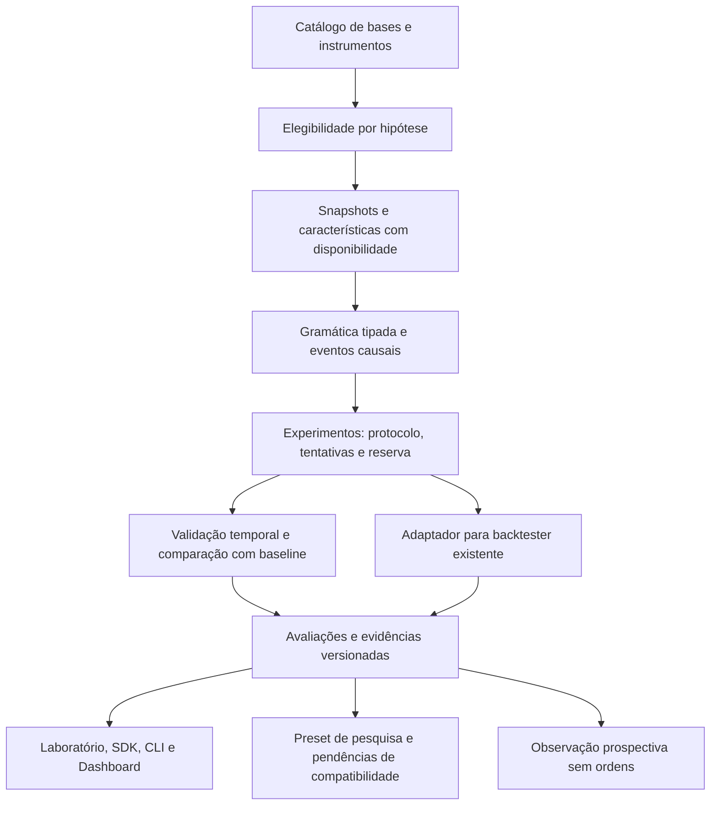

# Descoberta e validação de padrões — estudo e roteiro de implementação

Data: 02/11/2026. Revisão 1. **T13.4-P00: entrega documental.**
O proprietário pediu primeiro o estudo e o roadmap para execução por outro
agente. Não há motor novo implementado, varredura financeira, padrão aprovado
ou autorização de negociação nesta entrega.

Atualização de 03/11/2026: P01–P07 foram implementados em branches locais
encadeadas e ensaiados com bases sintéticas. Este texto preserva a fotografia
de P00; [continuidade](../continuidade.md) distingue a fonte proposta, os
testes e os gates de M1 ainda abertos. A prévia instalada não contém P01–P07.

Este documento detalha T13.4, com integrações em T13.6/8, T18, T19 e T20;
as tarefas e seus estados permanecem no [plano central](../PLANO_DE_TRABALHO.md).
Complementa a [especificação F13](ESPECIFICACAO.md), a
[diretriz de Dados](../dados/DIRETRIZ_BASE_ESTRATEGICA.md), o
[plano de Dados](../dados/PLANO_ESTRUTURA_DADOS.md) e as
[fichas F20](../propostas/PLANO_F20_ROBUSTEZ.md). Não substitui seus donos.

## 1. Decisão de arquitetura

Implementar a inteligência como uma capacidade do Analytics e do pilar de
estratégia do App, consumindo o catálogo, os cálculos, os snapshots e o registro
de experimentos existentes. As regras produzem eventos explicáveis; um
adaptador de simulação usa o backtester já existente. Laboratório, SDK, CLI e
Dashboard consultam a mesma avaliação persistida.

O primeiro marco deve percorrer **dados → regra → eventos → baseline → validação
temporal → simulação → catálogo → preset de pesquisa**, com reversão percentual,
continuação condicionada a horário, gaps e rompimento/falha. Apenas depois
ampliar para combinações, sequências, relações entre ativos e similaridade.
Concluir que nenhum candidato passou é um resultado funcional válido.



Não criar banco de pesquisa por execução, outro registry de indicadores,
backtester, ledger, executor, cache ou scheduler. As novas entidades de padrão
pertencem ao store analítico existente; tentativas e acessos à reserva pertencem
ao registro `experiments`. Dados privados ficam fora do Git público.

## 2. Fotografia técnica confirmada

Base inspecionada: App `c956305532e85204078299370ef4a24608294574`, branch de
origem `codex/e14-protecao-comum`, [PR279](https://github.com/Misael-art/MISA_MT5-Extra-o-de-Dados/pull/279),
aberta e draft, com base `codex/f04-vinculo-presets`. Nesta consulta, checks
Linux, PostgreSQL, instaladores e lint estavam aprovados; Windows ainda estava
em andamento. Isso não qualifica o futuro motor nem Windows físico.
HADOUKEN `adc5ecd360a41e575068fb443d2a531e7f82c87b` estava na branch operacional;
Safety `27b85992af4b10f4cd7687f370142ac88f515375`, detached. Nenhum componente
foi editado ou repinado para este estudo; o sucessor deve revalidar a composição.

| Responsabilidade | Evidência no código atual | Reuso e lacuna |
|---|---|---|
| Universo armazenado | `database_manager.py`: `data_inventory`, `_symbol_tables`, `_symbol_specs`; `laboratory/service.py:sources` | Descobrir base e séries, sem lista de tickers. Catálogo do banco não é universo histórico completo da bolsa |
| Identidade histórica | `analytics/instruments.py`: `_instrument_facts`, `history`, `universe_at`, `require_supported_spec` | Existem contratos de vigência, conhecimento e restrições; preenchimento e alcance precisam ser verificados por base |
| Qualidade | `analytics/data_eligibility.py`: `assess`, `evaluate`, `as_of` | Reusar capacidades e motivos. Acrescentar requisitos específicos das famílias |
| Sessões e barras | `analytics/calendar.py`, `resampling.py`; calendário congelado em `datasets` | Reusar calendário observado; grade atual não prova feriados/horários históricos |
| Cálculos | `analytics/indicator_registry.py`, `indicator_materializer.py`, `producers.py`, `producer_jobs.py`, `strategies/indicators.py` | Fórmula, unidade, versão, aquecimento e disponibilidade já têm donos. Indicadores são opcionais |
| Fatos e snapshots | `analytics/feature_store.py`, `query_service.py`, `datasets.py` | `_feature_definitions`, `_feature_values`, consultas as-of, blocos deduplicados e manifestos. Sem copiar toda a base por candidato |
| Linguagem declarada | `strategies/declared.py`: `SignalSpec`, `DeclaredStrategy` | Hoje exige SMA/EMA/RSI e quatro operadores. Não comporta toda a gramática pedida; preservar o contrato nativo existente |
| Sinal e simulação | `strategies/base.py`, `backtester.py`, `equity.py`; `composition/adapter.py` | Sinal no fechamento, entrada seguinte, stop-first e custos modelados. Separar eventos sem operação de sinais com stop/capital |
| Experimentos | `experiments/schema.py`, `store.py`, `service.py`, `relations.py` | Protocolo, alternativas, execuções, eventos e acessos já persistem. A qualificação de reserva final permanece explicitamente falsa |
| Estatística | `analytics/associations.py`, `experiments/relations.py`, `strategies/validation.py` | Há bootstrap por sessões, Bonferroni e walk-forward em escopos específicos. Faltam avaliação de eventos e controle da campanha ampla |
| Recursos | `robots/budget.py`, Recursos e guards existentes | Cancelamento, jobs, checkpoints e retenção. O protocolo inicial limita o pedido, não a campanha inteira |
| Presets | `presets/compiler.py`, `store.py`, `composition/schema.py` e adaptadores nativos | Pacote fechado e versionado; regras arbitrárias ainda não mapeiam para `.set`. Não ampliar inputs por conversão implícita |
| Consumidores | `laboratory/service.py`, `inventory.py`, `report.py`, `sdk.py`, `cli.py`, UI | Congelamento, séries, relações e relatórios existem; integrar pesquisa de padrões neles |
| Dashboard | `dashboard/sections.py:hypothesis`, `generator.py`; testes DASH-06 | DTO estrito já previsto; gerador devolve `T13_4_PENDING`. Não há produtor real de `pattern_evaluations` |

`analytics/hypotheses.py`, `pattern_engine.py` e o avaliador F13 ainda não
existem nesta fotografia. `pattern_definitions`/`pattern_evaluations` são
entidades previstas, não tabelas comprovadamente produzidas.

### 2.1 Código disponível não significa base qualificada

Foi feita leitura de metadados da base restaurada com SQLite `mode=ro` e
`query_only`, sem instanciar migrações, capturar snapshots ou ler resultados de
negociação. Há catálogo legado e snapshots/presets/experimentos; nessa base
não existem `_market_calendar`, `_instrument_facts`, `_feature_definitions`,
`_feature_values` nem tabelas de padrões. Símbolos, preços, operações e conteúdo
dos snapshots privados não integram este documento público.

Não foi realizado perfil completo de qualidade, cobertura, sessões ou
eligibilidade. O offset configurado atualmente não comprova a convenção de
todo o histórico. `datasets.capture` exige offset fixo conhecido; o caminho
do Laboratório explicita que timezone variável/DST ainda requer evolução.
Essa é uma dependência concreta de Dados para estudos por horário, não um
motivo para presumir UTC ou impedir estudos que não dependam dessa capacidade.

Limitações do simulador a tratar por capacidade: preço assumido como BID,
especificação constante no recorte, defaults econômicos genéricos e comissões/
slippage zero permitidos pela API antiga. O contrato novo deve exigir premissas
explícitas. Ativos com outra base de cotação, multiplicador/conversão variável,
vencimento ou financiamento não suportado ficam bloqueados na simulação
econômica, mesmo quando admitirem estudo estatístico de preços.

### 2.2 Lacunas que mudam a ordem de implementação

1. Identificar o instrumento e a fonte sem depender só do símbolo textual;
   distinguir série de contrato, contínua ajustada e execução negociável.
2. Qualificar relógio/sessão e disponibilidade antes de reconhecer horário,
   gaps, extremos de sessão ou relações entre mercados.
3. Estender a linguagem de pesquisa além dos indicadores; compartilhar o
   avaliador causal entre lote e incremental, sem alegar compatibilidade MQL5.
4. Completar o registro de campanha, tentativa e reserva antes de buscar
   vencedores. O registro atual não certifica holdout intocado ou escopo global.
5. Acrescentar baselines de eventos e validação por blocos no serviço canônico;
   a correlação de um relatório já exposto não é aprovação de uma estratégia.
6. Adaptar o motor de simulação e os presets com elegibilidade explícita;
   regra exportada sem mapeamento nativo permanece pesquisa.

## 3. Posse e fronteiras

| Pilar | Entrega deste roteiro | Limite |
|---|---|---|
| Dados — extração | Catálogo/capacidades, origem, qualidade, calendário e especificações históricas | Sem coletor novo; nenhuma campanha ampla de extração para fabricar amostra |
| Dados — cálculo | Retornos, referências, geometria, normalização e indicadores como definições versionadas | Fórmulas e materialização no registry/store/produtores existentes |
| Estratégia | AST, hipóteses, eventos, desfechos, baseline, busca, validação, classificação e preset de pesquisa | Resultado futuro não é atributo do sinal |
| Operações | Contrato de entrada/saída/risco/custo e adaptador do backtester | Sem ordens, PLAY, alteração de Safety ou executor paralelo |
| Consumidores | Consulta das mesmas avaliações no Laboratório/SDK/CLI/Dashboard | UI não calcula lift, aprovação ou ranking por conta própria |

O escopo inicial é Python/App. HADOUKEN/Safety só entrarão numa ficha própria
de compatibilidade futura, com leitura das instruções, revisão de contrato,
paridade e reconciliação explícita da composição. Preservar o pilar operacional
em andamento e suas autorizações separadas; nenhuma delas é transferida para
esta pesquisa.

## 4. Contratos a implementar

Nomes abaixo são contratos **propostos**, não APIs ou comandos disponíveis.
Novos módulos de domínio concretizam a F13; persistência, estatística geral e
recursos continuam nos componentes donos já identificados.

### 4.1 Universo, dados e elegibilidade

`UniverseSnapshot`: origem/base/feed, identificador canônico, símbolo original,
aliases, classe, contrato/vencimento, moeda/unidade, tick/valor por ponto/lote,
base de preço, calendário e versões/vigências. Campos desconhecidos ficam
desconhecidos. Cada candidato guarda o roster e a regra de inclusão na data;
universo composto apenas por sobreviventes recebe essa limitação.

`EligibilityReport`: por fonte/instrumento/TF/família e intervalo, registrar
início/fim efetivos, linhas, sessões identificadas, campos disponíveis, ausências
versus zeros, duplicatas, ordenação, preços inválidos, barras abertas, gaps e
capacidade de execução. Distinguir inelegível, desconhecido, falha técnica e
não processado por orçamento. Não converter falta de dado em condição falsa.

Descobrir primeiro séries existentes por `data_inventory`; ticks/book são
famílias distintas de OHLC. Acesso opcional a novos ativos do MT5 usa somente
o conector oficial e seu catálogo, em etapa explícita de ingestão. Não supor
que todos os símbolos disponíveis no terminal tenham histórico elegível.

Preservar UTC da fonte e conversão comprovada para sessão; congelar o calendário
histórico usado. Sessão observada, inferida e oficial são estados diferentes.
Sem grade histórica não calcular completude contra a grade semanal atual.
Não preencher pausas, feriados ou intervalos sem negócios artificialmente.
Revisão de preço, ajuste societário ou rolagem invalida apenas dependentes
alcançados; o snapshot anterior continua reproduzível.

### 4.2 Definição executável e identidade

`PatternDefinition` imutável deve conter:

```text
schema_version, pattern_id, definition_hash, strategy_version,
original_hypothesis, origin(user|exploratory|derived), parent_attempt_ids,
universe_definition, data_requirements, timeframe,
timezone_calendar_versions, features_and_versions,
context_expression, condition_expression, decision_clock,
price_reference, side, simulated_entry, outcome_definition, horizon,
repetition_policy, invalidation_rules, execution_policy,
cost_model_id, complexity, implementation_signature
```

Hash canônico inclui lado, regras, referência, parâmetros, horário/fuso,
horizonte, repetição e saídas. `pattern_id` identifica a linhagem; versão/hash
identificam a regra exata. `candidate_id` liga definição, universo, parâmetros
e protocolo; `evaluation_id` também liga snapshot, custos, folds e código.
Nome de apresentação e ticker isolado não são identidade da estratégia.
Compra e venda no mesmo ativo coexistem sem alterar configurações uma da outra.

Implementar AST JSON tipada, sem `eval`/execução de texto. Operandos declaram
tipo, unidade, período, janela, disponibilidade, validade e warmup. Decimal
`0.013` representa 1,3%; não aceitar `1.3` como fração por adivinhação.
Variação percentual exige referência positiva válida; séries com preços não
positivos precisam de outra transformação declarada.

| Grupo de operadores | Semântica e restrição |
|---|---|
| Comparação/faixa/distância | Operandos com unidades compatíveis; igualdade e tolerância de tick explícitas |
| Cruzamento/primeiro toque | Exigir estado anterior conhecido; separar cruzar, tocar e permanecer acima |
| Contagem/duração/sequência | Janela retrospectiva limitada, reset por sessão e política de ausência |
| Velocidade/aceleração/inclinação | Unidade por tempo ou por barra explicitada; nenhuma janela centralizada |
| Quantil/z-score/volatilidade | Ajuste só no treino; scaler/regime congelado por fold |
| AND/OR/NOT e temporal | Lógica com desconhecido propagado; limites de profundidade, termos e lookback |
| Interativo/multiativo | Join as-of por disponibilidade, tolerância de atraso e calendário de cada fonte |

O avaliador causal é único: `evaluate_prefix(state, observation)` e avaliação
em lote devem produzir os mesmos eventos sob o mesmo corte. O estado incremental
guarda versão e última observação confirmada. Testar prefixos, restart e revisões.
Disponibilidade histórica da cotação e instante de ingestão atual são diferentes:
reconstrução retrospectiva não pode fingir recepção prospectiva no passado.

O `SignalSpec` legado continua válido. Reusar seus operadores/fórmulas por
adaptador para o subconjunto equivalente, sem ampliar silenciosamente o gerador
MQL5. A AST ampla de pesquisa terá versão própria e declaração de compatibilidade.

### 4.3 Eventos e desfechos

`PatternEvent`: candidato, snapshot/blocos, sessão, instante de observação,
disponibilidade e decisão, valores da condição/referência, elegibilidade,
entrada simulável posterior, fim do horizonte, MFE/MAE, tempo até barreiras,
retorno terminal, completude e motivo. A tabela de desfechos é separada da
vista acessível ao avaliador de sinais.

Decisão de fechamento de barra só usa OHLC final depois de fechar. Entrada
é a primeira observação executável **posterior** à disponibilidade do sinal,
com atraso e ordenação explícitos. Sinal no fechamento não compra na máxima,
mínima ou abertura anterior da mesma barra. Timestamp igual entre fontes não
resolve sozinho a ordem de informação/execução.

Cada estudo declara `first_per_session`, cooldown, reentrada e posição aberta.
Guardar todos os eventos estatísticos e quais foram descartados pelo plano de
capital. Eventos sobrepostos podem ser analisados como dependentes, jamais
como amostra independente por padrão. O simulador também registra sinais
bloqueados por posição/capital/liquidez, sem apagá-los do denominador.

Separar sessões elegíveis, oportunidades, eventos completos, censurados e
operações realizáveis. Sem horizonte futuro, gap material ou saída não
observada: censura/indisponibilidade, sem classificar como perda ou sucesso.
Não interpretar o fechamento `end` do backtester como saída planejada quando
o estudo terminou antes do horizonte da regra.

## 5. Famílias e ordem de expansão

| Marco | Família e regra inicial | Dados e testes adicionais |
|---|---|---|
| M1 | Reversão após deslocamento percentual ou em unidades de volatilidade | Referência conhecida; lados opostos; retorno terminal e MFE/MAE separados |
| M1 | Continuação por horário fixo, primeiro cruzamento e condição atingida até horário | Três regras distintas; calendário/fuso; entrada posterior; fechamento especial |
| M1 | Gap: preencher/parcial, continuar e falhar | Sessões anterior/atual comparáveis; proventos/rolagem; não lucrar retroativamente com o gap |
| M1 | Rompimento/falha de faixa ou nível conhecido | Faixa inicial já encerrada, D-1 ou nível explícito; confirmação/reteste só quando observáveis |
| M2 | Sequências, impulso–recuo, compressão–expansão e geometria | Comprimentos/janelas finitos; pavios/amplitude/inclinação objetivos; rejeição de lookahead |
| M2 | Horário/calendário, volatilidade e liquidez | RVOL no mesmo horário do passado, spread disponível; volume de ticks, negócios e financeiro distintos |
| M2 | Combinações de contextos | Até poucos termos por protocolo; suporte e custo de cada filtro contados na busca |
| M3 | Relações entre ativos e padrões de grupos | Fonte/identidade e sincronização as-of; cortes globais por data; grupos aprendidos no treino |
| M4 | Similaridade, motivos, clusters, árvores rasas e descoberta simbólica | Escala/representação/seleção ajustadas no passado; comparação com regras simples sob igual orçamento |

O catálogo aceita famílias futuras por um contrato de gerador/elegibilidade/
avaliador, sem hardcode por ativo. Não promete enumerar todos os padrões
matemáticos. Regra específica de um ativo pode ser válida nesse domínio;
padrão compartilhado exige incerteza por ativo e peso que não esconda os
resultados individuais. Não extrapolar resultado de um símbolo aos demais.

H01–H05 da F13 permanecem registradas com sua semântica original; hipóteses
descritivas de volume/regime não viram ordens automaticamente. O novo exemplo
do proprietário não substitui H02 nem herda seus percentuais/horários.

### 5.1 Registro pendente: “Infut sobe 1,3% até as 5h25 e sobe mais 0,75%”

Manter `DRAFT`, sem executar ou escolher a interpretação mais lucrativa.
Pendências: instrumento/contrato/série; 05:25 versus 17:25 e fuso; referência
dos 1,3%; primeiro toque/cruzamento versus condição no instante fixo;
referência dos 0,75% e horizonte; toque versus retorno terminal e prioridade
de barreira adversa. O sucessor só pede essas definições ao executar esse caso;
as famílias genéricas não dependem dessa resposta.

Depois de resolvidas, registrar cada interpretação autorizada como tentativa
distinta. A condição pode ser `P(t)/P_ref - 1 >= 0.013`; desfecho de toque pode
ser `max(P(u)/P_entrada - 1) >= 0.0075` numa janela futura definida. Esse evento
é uma medida de comportamento. Lucro exige entrada, preenchimento, saída,
custos e capital simulados separadamente.

## 6. Protocolo estatístico proposto

Esta seção é uma decisão de engenharia para implementação e calibração,
não evidência empírica de vantagem nem certificação de um método universal.

### 6.1 Cortes e reserva

Congelar antes da busca: universo, dados, endpoints primários/secundários,
baseline, efeitos mínimos relevantes, critérios, grade, orçamento e períodos.
O protocolo exige alpha, nível dos intervalos, efeito mínimo, limites de risco
e política de seleção numéricos/versionados; parâmetro ausente impede promoção,
sem importar defaults do Filtro C legado.
Usar descoberta/treino, validação temporal e teste final reservado por datas
UTC; todos os ativos compartilham as fronteiras da campanha. Não fixar
percentuais de divisão universais: a duração precisa comportar warmup, regimes,
horizontes e precisão justificáveis; caso contrário, evidência insuficiente.

No desenvolvimento, walk-forward com ajuste de quantis, regimes, filtros,
saídas e parâmetros apenas no passado de cada fold. Purgar observações cujo
intervalo de desfecho intercepte a janela avaliada; gap/embargo em tempo real
ou sessões, fundamentado no maior horizonte e dependência. Warmup passado
pode ser lido sem pontuar; labels futuros não podem atravessar fronteiras.
Em dados irregulares, um número fixo de linhas não representa a mesma duração.

O `walk_forward` atual particiona por barras, faz busca da grade da estratégia
e Monte Carlo de retornos de trades; não resolve sozinho a campanha de eventos,
reserva final e dependência. O novo protocolo deve versionar a evolução do
serviço, preservando leitores/resultados antigos. `TimeSeriesSplit` é apenas
referência de cortes cronológicos e gap em amostras, não implementa a purga
dos intervalos de eventos. [Documentação oficial](https://scikit-learn.org/stable/modules/generated/sklearn.model_selection.TimeSeriesSplit.html).

O acesso a resultados da reserva ocorre em serviço único, registrado antes da
leitura. Busca e refinamento não recebem resultados do teste final. Abrir um
relatório/gráfico ou exportar resultado de holdout também conta como acesso.
Uma revisão nova não limpa exposição anterior: correlacionar escopo da fonte,
instrumento e intervalo, inclusive sobreposições e protocolos sucessores.
Timestamps, contagens mínimas e qualidade podem ser inventariados sem abrir
desfechos; a fronteira de metadados versus resultados deve ser testada.

As bases já estudadas têm exposição externa desconhecida. Manter isso explícito:
um acesso controlado agora não transforma o passado em holdout intocado.
Exigir nova janela de confirmação ou dados futuros para a dimensão de evidência
que dependa de reserva independente. Restrição dentro do App é auditável,
mas não prova ausência de consultas externas ao banco pelo proprietário.

### 6.2 Baseline, incerteza e dependência

Comparar distribuição condicional com oportunidades sem a condição, do mesmo
instrumento, horário/faixa, horizonte e contexto pré-definidos. Formação de
faixas e matching só usa informação disponível no treino/decisão; não parear
por lucro futuro. Checar suporte comum, desequilíbrio e quantidade de controles;
sem comparabilidade, bloquear conclusão. Baseline incondicional fica apenas
como diagnóstico secundário identificado.

Reportar probabilidade de barreira, diferença de probabilidade, retorno médio/
mediano e quantis, tempo até desfecho e MFE/MAE. `lift` com baseline zero é
indefinido; não usar infinito no ranking. Declarar pesos de eventos/sessões;
usar sessão como unidade inicial de agregação e dependência, preservando
clusters por data entre ativos no estudo compartilhado.

Estender `analytics/associations.py` para inferência de eventos, reusando suas
primitivas verificadas quando os pressupostos coincidirem. Bootstrap de blocos
de sessões preserva observações internas; tamanho de bloco e esquema nulo
precisam de justificativa/calibração no desenvolvimento. Não copiar a troca
de sinais de um teste de correlação para qualquer desfecho sem validar simetria/
hipótese nula. Publicar método, IC, réplicas válidas, sessões/blocos, seed e
falhas de identificabilidade. Amostra insuficiente não recebe IC artificial.

### 6.3 Busca múltipla e adaptação

Primeiro protocolo confirmatório: grade finita congelada e endpoints contados,
com Bonferroni conservador sobre **toda a família planejada**; reusar a função
existente, sem aplicar correção só aos finalistas. Manter IDs de todas as
alternativas, inclusive manuais, saídas, horários, refinamentos, descartes e
falhas. Repetição técnica idêntica/cache não cria hipótese nova nem observação
independente. Candidato não estimável não desaparece do registro de busca.

Exploração adaptativa é permitida no desenvolvimento. Antes de validar,
congelar seus candidatos e reservar janela não usada para criá-los. O contador
total por si só não corrige seleção adaptativa no mesmo conjunto. Não declarar
controle global entre campanhas independentes apenas por corrigir cada PR.
Campanhas sucessoras compartilham histórico de exposição e um orçamento de
erro/protocolo de confirmação definido antes dos testes; na ausência dele,
o resultado continua exploratório. Métodos max-T/stepdown ou alpha spending
são extensões posteriores, com revisão e testes próprios.

Réplicas precisam ter resolução compatível com o limiar corrigido. Com 999
réplicas e p mínimo 1/1000, não se pode declarar significância num limiar menor
por retornar p=0. Dimensionar réplicas antes da avaliação ou registrar
`insufficient_inference_resolution`; orçamento esgotado não flexibiliza o gate.
IC pontual e conclusão ajustada são dimensões distintas; rotular IC não
simultâneo ou implementar limite simultâneo quando o critério exigir.

PBO trata risco de seleção entre configurações e requer uma matriz comparável
de desempenhos; não é substituto automático de um teste temporal reservado.
[Artigo dos autores](https://www.davidhbailey.com/dhbpapers/backtest-prob.pdf).
DSR é diagnóstico complementar apenas quando existirem série de retornos,
momentos e informação sobre tentativas/dependência compatíveis; não calculá-lo
sobre taxa de toque ou usar o número bruto de variantes como independência
comprovada. [Artigo dos autores](https://www.davidhbailey.com/dhbpapers/deflated-sharpe.pdf).

### 6.4 Gates e ranking

Antes de ordenar: qualidade/cobertura compatíveis, condição causal, baseline
comparável, tamanho de efeito e incerteza aceitáveis, validação temporal,
seleção controlada, custos/execução e limites de risco definidos. Amostra deve
ser justificada por sessões independentes, precisão e efeito; não herdar o
default legado de 100 trades como certificado universal.

Sensibilidade: parâmetros vizinhos, janelas, regimes, atraso, custos, exclusão
dos melhores dias e comportamento sem cada filtro. Essas variantes contam
no protocolo; não usar o teste final para escolher a vizinhança. Mostrar região
estável, não apenas máximo isolado. Para exigir vantagem econômica, declarar
antecipadamente efeito líquido mínimo e como sua incerteza será julgada.

Começar com filtros e comparação de compromissos/Pareto, sem score agregado
opaco. Expor efeito, expectativa líquida, IC, estabilidade, frequência,
complexidade, cauda e restrições. Agrupar equivalentes por regra e correlação
de eventos/resultados no desenvolvimento; não reduzir retroativamente o número
de testes por agrupá-los. “Campeã” só entre elegíveis sob critérios congelados;
troca gera nova evidência e observação, sem rotação pelo mesmo teste final.

## 7. Simulação e compatibilidade de preset

Gerar sinais para `strategies.backtester.run_backtest` por um adaptador de
pesquisa; não reimplementar PnL, sizing ou fills no pattern engine. Eventos de
toque/retorno usam o avaliador estatístico; não precisam inventar stop para
existir. A transformação em estratégia exige políticas de stop/saída/capital
compatíveis com `Strategy`, `ExitRules`, `SymbolSpec` e o motor existente.

Declarar: entrada após disponibilidade, mercado/limitada, latência, stop/target
e sua âncora, tempo máximo, horário de saída, overnight, reentrada, quantidade,
capital e concorrência. Stop em pontos no fill e stop em percentual do sinal
são regras distintas. Se uma política necessária não for representável,
estender os tipos/motor canônicos com regressão ou devolver incompatibilidade;
nunca aproximar silenciosamente. Primeira versão usa ordens simuladas a mercado;
ordem limitada fica inelegível até existir modelo de preenchimento adequado.

`CostModel`: origem, vigência, moeda, base de preço, bid/ask ou proxy de spread,
comissão por lado/lote, taxas, slippage, financiamento/aluguel e cenários de
stress. Custos desconhecidos geram cenários explicitamente hipotéticos ou
bloqueiam promoção econômica. Zero é permitido somente com origem/hipótese
declarada; não aceitar defaults antigos como conhecimento dos custos reais.
Curvas de spread estimadas no futuro também vazam: ajustar apenas no passado.

Para instrumento linear suportado: PnL bruto = lado × (saída − entrada) ×
quantidade × multiplicador; no `SymbolSpec`, a conversão já usa
`tick_value/tick`. Não multiplicar novamente por `contract_size` sem contrato
que o exija. Validar tick versus point, lotes versus contratos e conversão para
moeda da conta. Mudança de especificação ou vencimento exige segmentação e
restrição do motor atual, não uso retroativo da especificação presente.

Stop e alvo no mesmo candle: contabilizar ambiguidade e aplicar stop-first
explícito ou dados mais granulares disponíveis, com cenário separado. Gap além
do stop sai na primeira execução possível; toque não comprova fill de limitada.
Não inferir bid/ask, volume negociado, agressão, participantes ou book de OHLC.
Recompras/tesouraria/fluxo institucional ficam como interpretação hipotética,
sem atribuição causal a partir de preço/volume.

Resultado: expectativa líquida, acerto, ganho/perda médios, payoff/PF com estado
indefinido apropriado, caudas, duração, frequência, exposição e curva de capital.
Conservar distinção entre drawdown de saldo fechado e patrimônio flutuante
do `equity.py`. Resultado por ativo com capital próprio não representa carteira
multiativo agregada; concorrência/capital comum requerem política específica.

### 7.1 Artefato de pesquisa e pacote operacional

Adicionar contrato versionado de pesquisa como extensão explícita do fluxo
`presets`, com `schema_version`, definição/hash de padrão/versão de estratégia,
símbolos/contratos, fuso/calendário/TF, versões das features, expressões,
referências/janelas/lado, entrada/saída/repetição, liquidez, risco/capital/custos,
validade, critérios de suspensão e IDs/hashes de evidências. Pendências são
estruturadas; `allows_real=false` em todo este roteiro.

O schema de `Composition` e o pacote v1 são fechados. Não anexar campos ao v1
por conveniência. Fazer extensão versionada com leitor próprio ou sidecar
referenciado por hash; conteúdo necessário para reproduzir o sinal deve ir no
artefato, não só um ID de banco local. Usar o catálogo de presets existente
para identidade/revisão, mantendo legados legíveis. Se o suporte persistido
ainda não couber no v1, a migração aditiva integra a mesma ficha.

Exportar/importar/reavaliar pelo MESMO avaliador Python deve reproduzir eventos
e simulação no snapshot referenciado. `.set` só pelo compiler atual quando
existir mapeamento integral e validado para inputs de um robô. Uma AST sem
consumidor MQL5 tem `native_mapping_pending`; um preset incompleto nunca é
elegível para operação. Gerar um arquivo não habilita execução real.

## 8. Persistência, execução e consumo

`pattern_definitions` e `pattern_evaluations` entram por migração aditiva em
`analytics/feature_store.py` (nomes físicos confirmados na ficha de schema).
Eventos/desfechos e vínculos de avaliação recebem relações normalizadas nesse
mesmo armazenamento, com índices por padrão/versão, ativo, tempo e protocolo.
`experiments/store.py` mantém protocolo, alternativa, tentativa técnica,
acesso à reserva, checkpoint e resultados descartados; sem journal paralelo.
Protocolo multiativo estende o contrato atual, hoje de uma única origem/ativo/TF.

Identidade de cache inclui dados/blocos, universo, features, AST, contexto,
calendário, custos, código, protocolo e fold. Revisão de qualquer dependência
material não herda aprovação. Guardar execução técnica separada de alternativa
científica e reaproveitamento de cache. Gravar admissão antes de computar;
publicar avaliação e checkpoint de forma transacional/idempotente.

Reusar `Budget`/`JobBudget`, guards e fila atuais. Acrescentar orçamento agregado
de campanha sem transformar cada hipótese em novo processo ou servidor.
Defaults propostos para o piloto técnico: 1 worker, 600s por lote, 512MiB de
memória incremental e 250MiB de artefatos próprios, até 4 ativos, 2 TFs e 200
alternativas no total, após expandir ativo/TF/lado/regras/saídas; não 200 por
ativo. Limites de 3 termos e profundidade 3 na AST. São tetos de exercício,
não critério financeiro nem varredura integral. O governor do host prevalece;
medir RSS total, margem de disco e recursos de outros projetos antes de iniciar.
Réplicas/folds/endpoints entram no custo estimado; sem orçamento, reduzir o
recorte explicitamente ou deixar a inferência pendente, sem reduzir proteções.

Particionar por instrumento/sessão e reutilizar blocos/atributos versionados;
vetorizar onde preservar semântica. Cancelamento cooperativo e checkpoint por
bloco/candidato; retomada verifica todos os hashes, não só o último ticker.
Reentrada concorrente no mesmo lote exige lease/trava existente. Falha entre
resultado e checkpoint, revisão da fonte e corrupção precisam de teste.

Cada execução publica cobertura real: universo descoberto, elegível por família,
processado, falha, ignorado com motivo, não visitado, regiões da grade e orçamento
consumido. Deve valer a reconciliação do roster; retomada não duplica contagens.
Datas exibidas são as dos dados efetivamente processados, não a data do relatório.

Interfaces propostas, a implementar na CLI/SDK existentes:

```text
analytics patterns inventory / register / search / status / resume / cancel
analytics patterns evaluate / catalog / show / events / export-preset
analytics patterns observe / observations
```

Cada comando precisa de `--help`, JSON estruturado, IDs estáveis e erros em
português; catálogo/show não disparam pesquisa, MT5, rede ou migração indevida.
Usar `./run.sh --cli` e o launcher oficial no aceite. Estes comandos ainda
não existem e não devem ser apresentados como receita executável nesta revisão.

Laboratório: filtros por origem/ativo/contrato/família/horizonte/estado/risco,
ocorrências boas/ruins/censuradas, baseline, trajetória, folds e vizinhança de
parâmetros. Dashboard: adaptar avaliações canônicas para
`status_namespace=hypothesis`, `hypothesis_id`, `version`, `available_at_utc`,
`n_events`, `p_condition`, `p_base`, `lift`, `confidence` e `oos`. O consumidor
recusa futuro/namespace inválido; não converter aprovação da bateria em padrão.

Preservar estados F13 `DRAFT/EXPLORATORY/VALIDATING/APPROVED/MONITORING/RETIRED`.
Acrescentar dimensões de qualificação e motivos, com mapeamento documentado:
descoberto→EXPLORATORY; insuficiente→EXPLORATORY com motivo; em validação→VALIDATING;
rejeitado→RETIRED com motivo; validado historicamente→APPROVED apenas com gates;
observação→MONITORING; suspensão→RETIRED com motivo de degradação. Retirada não
apaga prova nem transfere aprovação a sucessor. Compatibilidade e elegibilidade
futura são dimensões separadas. O Dashboard hoje não mantém MONITORING visível
como aprovado; conservar essa semântica até ficha explícita do consumidor.

## 9. Roadmap executável: uma ficha por PR

Dependências abaixo são por capacidade comprovada, não por rótulo de fase inteira.
Cada PR deve entregar comportamento exercitável; interfaces vazias não concluem
ficha. O marco M1 só fecha depois de P01–P07, sem alegar motor completo antes.

| Ficha e dono | Passos e arquivos principais | Dependência e aceite verificável |
|---|---|---|
| **T13.4-P00 — estudo** (este lote) | Inspeção, decisões, roadmap, vínculo com planos e repasse | Documentos e referências revisados; nenhum resultado financeiro alegado |
| **P01 — catálogo e qualificação** (BD03/04/05, T20.4/6) | Inventariar bases/capacidades; congelar seleção compacta pelo `datasets`; estender `instruments`, calendário e `data_eligibility` no que faltar | Contratos existentes; CLI/SDK devolvem elegibilidade por família, fonte/relógio/zero/ausência. DST variável é implementado com testes ou bloqueado por motivo; nunca inferido |
| **P02 — regras e eventos** (T13.4, BD06/08/18) | `analytics/hypotheses.py`, `pattern_engine.py`; operadores tipados e adapter do subconjunto `SignalSpec`; referências/percentuais, repetição e outcomes separados | P01; regra sintética conhecida gera eventos completos/censurados, lados e versões sem colisão; lote=prefixos=restart. Fórmulas novas no registry canônico |
| **P03 — campanha e reserva** (T20.12/24/25) | Estender `experiments/schema.py`, `store.py`, `service.py`, `robots/budget.py`; registrar grid/roster/endpoints/parentes e acesso antes de avaliar | P02; falha/cache/retomada não apagam tentativas, orçamento agregado funciona; holdout fechado para busca; sobreposição/revisão não limpa exposição; testar SQLite e PostgreSQL |
| **P04 — avaliação temporal** (T20.13, T13.4/F18) | Evoluir `strategies/validation.py` e `analytics/associations.py`; `analytics/validation.py` apenas como orquestrador F13; baseline, purga/embargo, IC e multiplicidade | P03; vazamento plantado recusado, folds globais e ajuste treinado só no passado; grade completa e resolução de p contabilizadas; calibração nula e efeito conhecido |
| **P05 — simulação econômica** (T20.3/5/8/9, T19) | Adaptador causal para `Strategy`/`run_backtest`; completar tipos/contratos econômicos no motor existente; journal de ambiguidades/censura e métricas | P02/03; long/short, tick/multiplicador, spread/custos, entrada seguinte, stop-first, capital e patrimônio conferidos por oráculos; não suportado fica explícito |
| **P06 — fluxo e quatro famílias** (T13.4/T19.25/T20.16/17) | Orquestrar P01–05; geradores reversal/time/gap/breakout-failure; avaliações/eventos no `feature_store`, ledger canônico, preset de pesquisa pelo fluxo `presets`; CLI/SDK | P04/05; fluxo completo reproduzível em duas bases sintéticas com símbolo igual e em amostra real elegível; catálogo inclui negativos/censura/custos; export/import reproduz; nenhum `.set` incompatível |
| **P07 — consumo e aceite M1** (T13.6, T20.22/23, DASH-06) | Integrar consultas no Laboratório/UI/HTML e produtor no Dashboard; ficha de padrão, filtros e inspeção; atualizar uso/instalação | P06; launcher real em QA isolada, CLI=SDK=GUI, consulta sem executar; catálogo e Dashboard usam avaliação real, resultado vazio suportado; dados privados não entram no Git |
| **P08 — sequências e contextos** (T13.4/F18, BD08/12) | Geradores de sequências/geometria/níveis/regimes/volume e combinações limitadas; testes de vizinhança/ablação no mesmo protocolo | M1; cada família percorre dados→preset com diagnóstico de requisitos e tentativas; RVOL e regimes aprendidos no passado; H01–H05 têm execução ou motivo de inelegibilidade |
| **P09 — relações e grupos** (BD16/T18.3/4/T20.13) | Estender joins/DTOs existentes para desempenho relativo/divergência/defasagem; protocolo multiativo e agrupamento treinado no passado | P08 + fontes sincronizáveis; cortes globais, atraso/fechamentos/fusos testados; efeitos por ativo e grupo, sem confundir correlação com previsão/causa |
| **P10 — similaridade** (T13.4/T18/T20.13) | Plugins de motivos/cluster/árvore rasa/simbólico, só após benchmark; manter tradução explicável e complexidade contabilizada | P08, P09 quando multiativo; melhoria sobre regra simples sob orçamento/protocolo equivalente ou extensão rejeitada; normalização e descoberta sem vazamento |
| **P11 — observação e suspensão** (T13.8/T20.18/19) | Estado incremental, sinais gravados antes do outcome, qualidade/domínio/deriva e suspensão; reusar monitor/fila, sem serviço novo | M1; prefixo=histórico, restart/revisão/alertas falsos testados; acompanhamento futuro real tem janela própria e não é certificado por replay |

Sequência inicial: **P01 → P02 → P03 → P04/P05 → P06 → P07**. P04/P05 são
desenvolvimentos independentes sobre contratos comuns; neste host, testes/builds
pesados continuam seriais. Expansão: P08 → P09; P10 só se trouxer ganho verificado.
P11 pode iniciar após M1 sem esperar similaridade. Não estimar prazo sem medir
o piloto e o tamanho das lacunas P01/P03/P05.

## 10. Testes e evidências exigidas

| Área | Casos mínimos com oráculo independente |
|---|---|
| Tempo causal | Candle aberto, OHLC final indisponível, H1 aberto ao avaliar M5, atraso/revisão, mutação de todo o futuro sem alterar prefixo, timestamp igual com ordem desconhecida |
| Calendário | UTC/sessão, DST histórico, meia-noite, feriado/fechamento especial, offset desconhecido e ausência de grade; não criar barras sem negócio |
| Identidade/unidades | Mesmo ticker em duas bases, long/short/saídas distintas, 0.013=1,3%, referência zero/negativa, point≠tick, lote/contrato e moeda/multiplicador |
| Eventos | Permanência≠cruzamento, primeiro toque, repetição/cooldown, sobreposição e posição aberta, ausência≠zero, horizonte incompleto e lacuna no futuro |
| Inferência | Efeito sintético conhecido; vários seeds sob nulo com autocorrelação/heterocedasticidade; sessões raras; baseline sem suporte; multiplicidade com descartados; resolução de p; treino/teste e purga por intervalo |
| Execução | Lucro comprado/vendido, entrada seguinte, spread e comissão por lado, slippage e gap, stop/target na mesma barra, limitada não suportada, patrimônio flutuante e capital concorrente |
| Reprodução | Export/import do preset e dados por hash, AST/código/custo alterados, versões antigas legíveis, checkpoint interrompido, corrupção, cancelamento, duas chamadas idempotentes e concorrência |
| Consumidores | CLI/SDK equivalentes, tabela/HTML/GUI com aprovados/rejeitados/insuficientes/censurados, Dashboard sem futuro ou falsa aprovação, observação sem chamar executor |

Não testar o método estatístico exigindo zero falsos positivos. Antes da
calibração, congelar DGPs, seeds, número de simulações, taxa-alvo, tolerância
Monte Carlo/intervalo e poder mínimo no efeito escolhido; não selecionar seeds
que favoreçam o teste. Ampliar o ensaio quando a incerteza da calibração não
resolver o critério. Massas sintéticas são prova técnica, nunca financeira.

Criar testes relevantes em `tests/test_pattern_*.py` e variantes PostgreSQL
quando houver persistência, mais regressões nos testes existentes de snapshots,
experimentos, backtester, presets, Laboratório e Dashboard. Executar ambiente
App preparado pelo wrapper; nenhuma dependência nova é necessária no núcleo
inicial (numpy/pandas/scipy/SQLAlchemy já existem). scikit-learn é referência,
não requisito novo deste plano; dependência de extensão exige uso e justificativa.

Gates de código: baseline dos módulos afetados, suíte pertinente e obrigatórios
do projeto, doctor, lint de shell apenas se houver `.sh`, CI do SHA e percurso
host pelo launcher em QA própria. `doctor --development --no-probe` certifica
somente offline. Testes sintéticos não exigem MT5 real; smoke real usa somente
leitura de dados ou simulação, jamais negociação REAL. Windows físico, MT5/Wine,
histórico, método estatístico e lucro são aceites separados.

### 10.1 Ensaio real limitado e política de dados

Selecionar deterministicamente por cobertura/capacidade, antes de ler desfechos,
até o teto do piloto. Usar janelas compactas e fontes já disponíveis; não
selecionar o ativo mais lucrativo para provar funcionamento. Congelar só os
blocos necessários em base de pesquisa/QA separada da base principal, sem
duplicar o banco inteiro. Sem família elegível na base, produzir diagnóstico
e deixar o aceite real correspondente pendente, mantendo o mecanismo testável.

O recibo registra fonte/base, ativos e períodos efetivos, metadados de ajuste/
execução, hash de dados/código/fórmulas, protocolo/folds/seed, todas as tentativas,
versões, censura, custos, limitações e consumo. Resultados reais somente quando
obtidos nessa execução. Amostras curtas podem demonstrar funcionamento e ainda
ser insuficientes para qualquer aprovação econômica. Não anunciar varredura
integral a partir desse piloto.

Preservar receitas/código no Git e dados/evidências privadas nos destinos já
previstos, com manifesto e proteção independente quando necessários à
reprodução. `.gitignore` não substitui backup. Não publicar histórico privado
no PR; não copiar base do proprietário para fixtures.

## 11. Critério de encerramento

**M1 funcional** requer P01–P07 integrados: descoberta automática do catálogo,
quatro famílias com formalização completa, registro de todas as tentativas,
eventos/baselines/censura, validação temporal e seleção, custos/risco de simulação,
catálogo consultável e preset reproduzível ou pendências explícitas, mais aceite
pelo launcher. Um conjunto vazio de padrões elegíveis passa o aceite técnico
se os motivos forem corretos e a cadeia tiver sido exercitada.
Sem ensaio real elegível, o mecanismo pode ter verificação técnica sintética,
mas o aceite integrado em dados reais permanece pendente; não declarar o marco
integralmente concluído nessa situação.

**Escopo ampliado** requer P08/09, e P10 apenas após sua prova de ganho; P11
entrega acompanhamento sem ordens, com a janela prospectiva efetivamente medida.
Compatibilidade nativa e integração futura com robôs continuam fichas próprias.
Não declarar T13.5/7, F19/F20 inteiras ou pilar operacional concluídos por este
marco. Não reutilizar holdout para fabricar confirmação ou aliviar gates.

### Repasse pronto para o agente implementador

> Implemente o roadmap desta revisão na composição MT5X oficial. Revalide primeiro
> AGENTS/RTK, registry central, CONTINUAR_AQUI, base Git/PRs/checks, pins e trabalho
> local, sem criar clone/worktree. Este documento é especificação de execução;
> os recursos e comandos novos aqui propostos ainda não existem. Comece por
> T13.4-P01, preservando o pilar operacional e os donos de Dados/cálculo.
> Reutilize snapshots, feature store, experiment registry, Budget, backtester,
> presets e consumidores identificados na seção 2. Complete uma ficha por PR;
> revise, teste, publique commit/PR e confirme SHA remoto conforme a política,
> sem merge/release automáticos. Atualize painel e continuidade no mesmo lote.
> Conduza P01–P07 até o fluxo funcional antes de declarar M1; depois execute as
> expansões elegíveis. Se faltarem dados reais, explicite capacidade/motivo e
> continue mecanismos independentes com massas sintéticas identificadas.
> Não envie ordens, não use REAL, não reutilize autorização DEMO anterior e não
> gere `.set` de regra sem contrato compatível. “Infut/5h25” permanece rascunho
> até definição indispensável. Ao entregar, informe como executar, famílias e
> bases efetivamente processadas, tentativas/cobertura, testes, custos, estados,
> evidências, limitações e próximos gates, aceitando honestamente zero aprovados.

## 12. Referências verificadas e alcance

- [MetaQuotes — copy_rates_from](https://www.mql5.com/en/docs/python_metatrader5/mt5copyratesfrom_py):
  documenta os campos OHLC, tick_volume, spread e real_volume, timestamps UTC e
  restrição ao histórico disponível no terminal. Não comprova calendário,
  identidade histórica, completude nem executabilidade da base local.
- [Bailey et al. — PBO](https://www.davidhbailey.com/dhbpapers/backtest-prob.pdf):
  fundamenta a preocupação com seleção de configurações e diagnóstico de
  sobreajuste; aplicação depende do desenho e das séries disponíveis.
- [Bailey e López de Prado — DSR](https://www.davidhbailey.com/dhbpapers/deflated-sharpe.pdf):
  referência complementar sobre inflação de desempenho por seleção e momentos
  dos retornos; não constitui garantia de lucro.
- [scikit-learn — TimeSeriesSplit](https://scikit-learn.org/stable/modules/generated/sklearn.model_selection.TimeSeriesSplit.html):
  referência de cortes ordenados e gap; não substitui tratamento dos intervalos
  de eventos, disponibilidade ou seleção adaptativa.

Os limites de piloto, interfaces, decomposição em fichas e escolhas de protocolo
deste documento são propostas de engenharia do estudo, sujeitas aos testes e
à calibração descritos; não foram extraídos como fatos financeiros das fontes.
