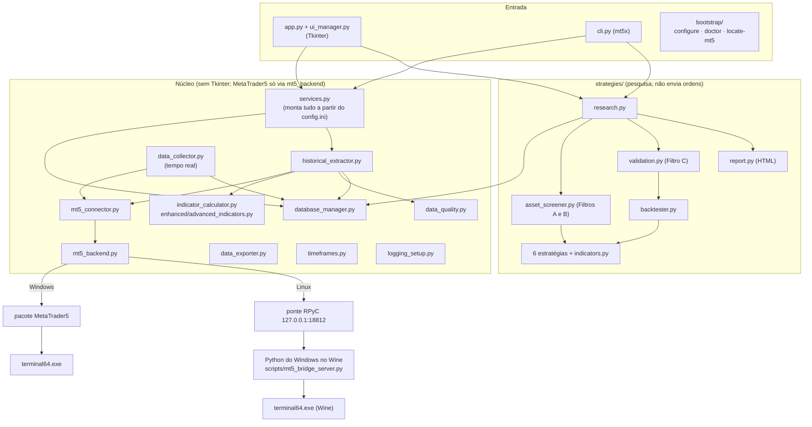

# Arquitetura

Visão do código como ele é hoje (atualize junto com mudanças estruturais). Regras para quem
altera o projeto: [AGENTS.md](../AGENTS.md). Próximos passos: [ROADMAP.md](ROADMAP.md).

## Visão geral

## Camadas

### 1. Instalação e configuração — `mt5_extracao/bootstrap/`

Roda **antes** das dependências existirem, por isso usa só a biblioteca padrão.

| Arquivo | Papel |
|---|---|
| `paths.py` | Caminhos padrão (projeto, `config/`, `logs/`, prefixo Wine, porta da ponte) |
| `mt5_locator.py` | Encontra `terminal64.exe` no Windows e dentro do prefixo Wine |
| `config_builder.py` | `DEFAULTS` de todas as chaves; gera `config/config.ini` (preserva o que o usuário editou), `.env` e `default_symbols.json` |
| `doctor.py` | Diagnóstico com a ação de correção para cada problema |

Os instaladores (`install.bat` → `scripts/install/windows.ps1`, `install.sh` → `scripts/install/linux.sh`)
preparam Python, `.venv`, MT5 (no Linux, Wine + Python do Windows + ponte) e chamam `bootstrap configure`.

### 2. Acesso ao MetaTrader 5 — `mt5_backend.py` e `mt5_connector.py`

- `mt5_backend.get_mt5()` é o **único** ponto que importa `MetaTrader5`.
  - No Windows devolve o pacote oficial.
  - No Linux devolve `RemoteMT5`, que fala com a ponte RPyC (`scripts/mt5_bridge_server.py`), rodando no Python do Windows dentro do Wine.
  - A ponte é **restrita**: só atende às funções de leitura da lista `ALLOWED` do servidor, não executa código
    enviado pelo cliente, não expõe módulos e não aceita pickle. Funções de ordem ficam de fora de propósito.
  - Argumentos e resultados viajam como texto JSON: datas como epoch, arrays numpy e namedtuples em tipos simples,
    que o cliente reconstrói. Cliente e servidor conferem o protocolo (`mt5x-bridge/2`); uma ponte antiga ainda em
    execução é recusada com a orientação de reiniciá-la.
- `MT5Connector` faz o resto:
  - inicialização com login do `.env`;
  - retentativas;
  - correção de nomes de símbolos;
  - gestão do processo do terminal via `psutil`;
  - `get_historical_data`, que devolve um DataFrame vazio (e não `None`) quando não há barras.
- Perguntas ao usuário passam pelo callback `ask_user`, assim o núcleo não depende de Tkinter.

### 3. Extração e armazenamento

- **`HistoricalExtractor`**
  - Divide o período em blocos (tamanho por timeframe em `[EXTRACTION]`).
  - Grava cada bloco assim que chega e o registra em `_extraction_log`.
  - Pula blocos já concluídos (retomada) e continua depois de falhas.
  - Aquece indicadores com as 500 barras anteriores.
  - `update_symbols` faz a atualização incremental, do último registro até agora.
- **`DatabaseManager`** (SQLAlchemy 2.0; SQLite por padrão ou PostgreSQL com `[DATABASE] type = postgresql`)
  - Upsert por `time` em lotes de 200 linhas.
  - Horário gravado como texto `%Y-%m-%d %H:%M:%S.%f`, na base de tempo configurada (`broker` ou `utc`), registrada em `_metadata`.
  - Tabelas internas (prefixo `_`) ficam ocultas nas listagens. As mudanças de schema são sempre aditivas.
- **`data_quality.check_quality`**: OHLC inválido, volume zero, duplicatas, lacunas no pregão e barras por dia. O relatório vai para `_extraction_log.quality_json`.
- **`DataCollector`**: coleta M1 em tempo real (botão "Iniciar coleta"), com indicadores do `EnhancedIndicatorCalculator`.

Tabelas internas:

| Tabela | Conteúdo |
|---|---|
| `_extraction_log` | Blocos extraídos (status `ok`/`empty`/`failed`, linhas, qualidade) |
| `_metadata` | Base de tempo do arquivo |
| `_symbol_tables` | Símbolo + timeframe → nome da tabela (sem colisão: sufixo de hash) |
| `_symbol_specs` | Especificação do contrato (tick, valor do tick, lotes, spread) |
| `_strategy_validation` | Veredito do Filtro C por símbolo × timeframe × estratégia |

### 4. Pontos de entrada

- `app.py` + `ui_manager.py` + `mt5_extracao/ui/`: interface gráfica em abas (Ativos, Minha base, Análise, Robôs, Atividade), com tema claro/escuro. Os números da aba Análise vêm de `study.py` (sem Tkinter). Os menus Arquivo, Exibir, **Estratégias** e Ajuda; extração, leitura da base e análise rodam em threads. As tabelas de ativos (favorito, volume, resultado dos robôs, status, benchmark) vêm de `asset_table.py` (sem Tkinter; favoritos e benchmark na tabela `_asset_prefs`), e o botão "Iniciar Backtest" da aba Minha base usa `robots/runner.py`, que roda os testes em segundo plano e regula quantos rodam juntos pelo uso de CPU e memória (`[ROBOTS] batch_max_*`).
- `cli.py` (`mt5x`):
  - Dados: `doctor`, `symbols`, `tables`, `extract`, `update`, `quality`, `export`, `schedule`.
  - Estratégias: `strategies`, `specs`, `backtest`, `validate`, `screen`, `report`.
  - Robôs: `robots list`, `robots import`.
  - Códigos de saída: 0 ok, 1 falha, 2 uso incorreto.
- `services.py`: GUI e CLI montam banco, extrator e fonte externa da mesma forma.
- `logging_setup.setup_logging()`: só os pontos de entrada configuram handlers. O log é `logs/mt5_extracao.log`, rotativo de 5 MB × 5.

### 5. Estratégias e triagem — `mt5_extracao/strategies/`

Guia do usuário: [estrategias.md](estrategias.md). Resumo técnico:

- `base.Strategy.gerar_sinais(df)`:
  - sinais no fechamento da barra;
  - colunas de entrada/saída, stop, alvo e ATR;
  - sem olhar o futuro, garantido por testes.
- `backtester.run_backtest`: barras bid com spread por barra, execução na abertura seguinte, lote por risco, stop/alvo/parcial/trailing/tempo/fim do dia.
- `validation.validate`: walk-forward, robustez de ±20%, Monte Carlo e veredito com critérios em português.
- `asset_screener.screen`: Filtro A (eliminatório) e Filtro B (score 0–100, regime, estratégia sugerida).
- `research.py`: orquestra tudo para a CLI e a GUI. A GUI roda em thread e conversa com o Tkinter por uma `queue.Queue`.

### 6. Robôs — `mt5_extracao/robots/`

Guia do usuário: [robos.md](robos.md). Plano: Fase 8 em [PLANO_DE_TRABALHO.md](PLANO_DE_TRABALHO.md).
**O Python nunca envia ordens** (`tests/test_no_order_send.py`); quem opera é o robô MQL5 dentro do MT5.

- `mql.py`: lê fonte MQL5 (propriedades, parâmetros por grupo, enums, includes, DLLs) e presets `.set`, sem o MT5.
- `risk.py`: classe de risco (Baixo/Moderado/Alto/Não avaliado) com os motivos, a partir de parâmetros e preset.
- `catalog.py`: `load_catalog(config, db)` junta as estratégias Python, as pastas de `[ROBOTS] library_dirs` e os
  robôs importados; `Robot` é o que a CLI (`mt5x robots`) e a aba "Robôs" mostram.
- `store.py`: tabelas internas `_robots` (robôs e pastas importados, estágio) e `_robot_runs` (backtests), criadas sob demanda.
- `contract.py`: contrato do robô (versão 1). Valida o `robot.json` e diz qual parâmetro cumpre cada papel
  (magic, risco, limites, stop). Especificação em [sdk/contrato.md](sdk/contrato.md).
- `safety_lib.py`: instala a biblioteca de segurança `mt5x-safety` (repositório próprio) na versão que o robô
  declara, a partir de um clone local (`[ROBOTS] safety_lib_dir`).
- `scaffold.py` e `templates/`: `mt5x robots new`, o esqueleto de um robô sobre a biblioteca de segurança.
- `generate.py`: `mt5x robots generate`, que preenche o esqueleto com o sinal MQL5 de uma estratégia declarada
  (`strategies/declared.py`: a mesma declaração roda no backtester Python).
- `parity.py`: `mt5x robots parity`, que compara as operações do robô MQL5 com as da estratégia Python.
- `pipeline.py`: `mt5x robots check`, que encadeia contrato, compilação, backtest e bateria e grava JUnit XML.
- `battery.py`: bateria de segurança. Itens de código e preset (compilação, stop, martingale, ordens fora da
  `Safety/`, DLL, magic, limites) e estatísticos sobre as operações do último backtest (Monte Carlo, ruína,
  estresse de custo). Resultado em `_robot_checks`; a bateria mais recente decide o estágio "Bateria".
- `live.py`: tempo real em conta demo. Travas, `.ini` de início com a conta conferida, acompanhamento por magic
  number (somente leitura) e PARAR TUDO (`HDK_KILL.txt`). Recusa conta real. Ainda não validado com o MT5 real.
- `mt5_tools.py`: pasta de dados do MT5, cópia do robô para `MQL5/` e compilação pelo MetaEditor (no Linux, por
  um `.bat` dentro do Wine), com o log lido em erros e avisos. Os executáveis entram por função injetada.
- `backtest.py`: `run_python` roda o backtester numa estratégia Python e grava métricas e curva de capital.
  `run_mql5` roda o robô MQL5 no Strategy Tester (`.ini` gerado por `mt5_tools`, terminal fechado), lê as
  operações do relatório ou do `HDK_trades_<magic>.csv` e calcula as mesmas métricas.
- Interface: `ui/robots.py` (grade de cards, filtros, importação) e `ui/robot_detail.py` (painel do robô).

## Configuração

`config/config.ini` (gerado pelo instalador; referência em `config/config.ini.example`):

| Seção | Uso |
|---|---|
| `[MT5]` | Caminho do terminal (`path`, `windows_path`, `wine_prefix`) |
| `[BRIDGE]` | Ponte do Linux (`enabled`, `host`, `port`, `wine_python`) |
| `[DATABASE]` | `type` (`sqlite`/`postgresql`), `path` (SQLite), `url` (PostgreSQL; senha em `DB_PASSWORD` no `.env`) |
| `[EXTRACTION]` | Tamanho dos blocos por timeframe |
| `[FALLBACK]` | Fonte externa para lacunas M1 |
| `[APP]` | Pregão (qualidade), base de tempo e fuso da corretora |
| `[STRATEGY]`, `[SCREENER]` | Capital, risco, custos e cortes dos Filtros A/B/C |
| `[ROBOTS]` | `library_dirs`: pastas com robôs MQL5 |

Credenciais ficam **somente** no `.env` (`MT5_LOGIN`, `MT5_PASSWORD`, `MT5_SERVER`).

## Testes

`pytest` sem MT5 real:
- `tests/fakes.py`: `FakeMT5` determinístico;
- `tests/fake_mt5_package/`: pacote falso para a ponte de ponta a ponta;
- `tests/market_data.py`: séries sintéticas para as estratégias.

O CI (Ubuntu e Windows) roda os instaladores sem MT5, o `shellcheck` e a suíte, com cobertura mínima de 60% em `database_manager`, `historical_extractor` e `mt5_backend`.

## Evolução planejada

O backlog integrado do HADOUKEN e do mt5x (framework modular de estratégias, execução, carteira, painel,
estatísticas, analytics e IA) está em [propostas/README.md](propostas/README.md). **É planejamento: nada do que
está lá muda a arquitetura descrita acima** enquanto não for implementado e validado. Regras que não mudam: o
Python não envia ordens; toda ordem passa pelo `HDK_SafeExecutor`; mudanças de schema são aditivas; o contrato do
robô versão 1 continua válido até haver migração especificada.
