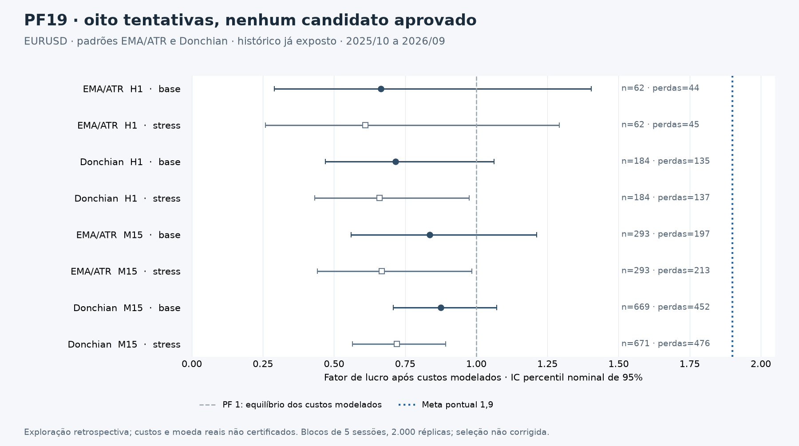

# PF19 — resultado do estudo limitado de2026-10-16

**A meta de PF líquido≥1,9 não foi demonstrada. Zero candidatos aprovados.** Todas as oito tentativas tiveram resultado negativo após os custos modelados; isso não equivale a custo líquido real certificado nem exclui outras estratégias/universos.

Universo registrado antes dos resultados no commit2383efd: EURUSD, H1/M15, EMAATR/Donchian com parâmetros padrão, custo base e cenário adverso. Código ce9fae9; oito execuções sequenciais, sem otimização ou aumento do risco de1%/capital100.000 já configurados. O aceite crítico da UI precedeu a execução. Dados já expostos são retrospectivos; nenhuma partição foi renomeada como OOS independente.

| Estratégia | TF | Custo modelado | Operações | Dias com operações | Perdas | PF | IC95% nominal por blocos | Resultado U | Queda fechada |
|---|---|---|---:|---:|---:|---:|---|---:|---:|
| ema_atr | H1 | base | 62 | 54 | 44 | 0.6650 | [0.2898; 1.4042] | -12009.19 | 18.31% |
| ema_atr | H1 | adverso_modelado | 62 | 54 | 45 | 0.6094 | [0.2587; 1.2924] | -14502.73 | 19.93% |
| donchian | H1 | base | 184 | 157 | 135 | 0.7165 | [0.4688; 1.0617] | -27460.13 | 34.30% |
| donchian | H1 | adverso_modelado | 184 | 157 | 137 | 0.6601 | [0.4319; 0.9756] | -33243.40 | 38.55% |
| ema_atr | M15 | base | 293 | 176 | 197 | 0.8366 | [0.5600; 1.2124] | -20925.04 | 34.16% |
| ema_atr | M15 | adverso_modelado | 293 | 176 | 213 | 0.6681 | [0.4417; 0.9839] | -42015.31 | 43.37% |
| donchian | M15 | base | 669 | 248 | 452 | 0.8758 | [0.7087; 1.0711] | -36924.22 | 46.94% |
| donchian | M15 | adverso_modelado | 671 | 249 | 476 | 0.7205 | [0.5655; 0.8927] | -69198.14 | 71.99% |

A melhor razão pontual observada foi Donchian M15 no custo base. A classificação é descritiva, sem seleção conhecida no passado nem aprovação para operar. O stress reexecutou toda a cadeia; no Donchian M15 o número de operações mudou, logo não foi simples subtração de custos no livro antigo.

O IC percentil nominal95% usa2.000 reamostragens de blocos circulares de5dias observados, incluindo dias sem operações; os ganhos e perdas são somados a partir de cada PnL individual. Todas as réplicas desta rodada tiveram denominador definido. O limite inferior ficou abaixo de1 em todos os casos. Dependência residual e seleção não corrigida limitam a inferência; esses ICs não são evidência OOS.

Os custos base são os configurados: comissão0 e slippage0, swap apenas conforme modo suportado e spread máximo entre barra/perfil. Isso não prova isenção de comissão. O perfil usa23dias distribuídos de2025-11 a2026-09 e foi medido depois de parte da janela. O cenário adverso duplica spread, acrescenta1ponto de slippage e comissão3,5U/lote/lado: hipótese administrativa, não tarifa de corretora. Moeda de lucroUSD não confirma moeda da conta; os resultados ficam em U. Não houve reconciliação com taxas/FX/execução real.

Período nominal2025-10-01 a2026-09-30; H1 inclui256barras anteriores. M15 começa na própria janela, portanto suas256barras de aquecimento reduzem a cobertura efetiva de negociação. Os timestamps e parâmetros exatos estão no JSON. Nenhum preço/volume/resultado foi corrigido para melhorar o PF. A auditoria independente do arquivo de trades reconciliou contagem, soma, ganhos/perdas e PF dos oito casos.

A queda é da curva de operações fechadas, com compounding existente; o limite de20% é critério de rejeição, não uma prova de stop/margem/patrimônio intraposição. Os gates completos estão no JSON, incluindo falhas de suporte, risco, concentração e estabilidade. Nenhuma aprovação depende apenas de PF ou treino. Não se executaram perturbações adicionais/atraso/Tester para transformar um caso reprovado em candidato; todas as oito tentativas e os logs estão preservados.

O próximo experimento é prospectivo e sem ordens: congelar hipótese/preset, instrumentar sinais disponíveis e custos/moeda/fuso/feed, reservar dados futuros e exigir≥60sessões,≥200operações e≥30perdas, além dos demais critérios originais. Antes de qualquer autorização financeira, um candidato elegível ainda precisará de estabilidade e reconciliação MQL5/Tester. Não aumentar lotes nem relaxar limites.



## Reprodução e artefatos

[Protocolo registrado](PF19_PROTOCOLO_20261016.json) · [Resultados e gates completos](PF19_RESULTADOS_20261016.json).

A base congelada, os oito livros completos, logs e manifesto com hashes permanecem nos artefatos privados desta execução; não são versionados. Para reproduzir, use o mesmo snapshot e versões, com caminhos locais próprios, a partir da raiz do projeto:

```bash
.venv/bin/python -m mt5_extracao.strategies.pf19_study --database "$PF19_DATABASE" --protocol docs/pesquisa/PF19_PROTOCOLO_20261016.json --output "$PF19_OUTPUT" --ui-acceptance "$PF19_UI_ACCEPTANCE"
```

O destino deve ser novo: a ferramenta recusa sobrescrever estudo anterior. Compare os hashes de código/protocolo/dados modelados e trades, não UUIDs externos. A ferramenta não conecta SDK/contas e não grava na base original. Saída0 significa oito cálculos concluídos, **não** sucesso financeiro.

PF segue a razão ganhos/perdas por operação; a política deste estudo mantém PF indefinido sem perdas, sem converter o sentinela nativo DBL_MAX em robustez. Referências: [relatório do MT5](https://www.metatrader5.com/en/terminal/help/algotrading/testing_report) e [estatísticas MQL5](https://www.mql5.com/en/docs/constants/environment_state/statistics). Não houve confirmação nativa MT5 nesta campanha.
