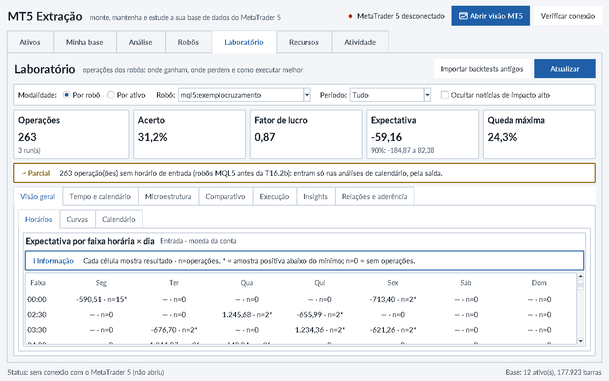
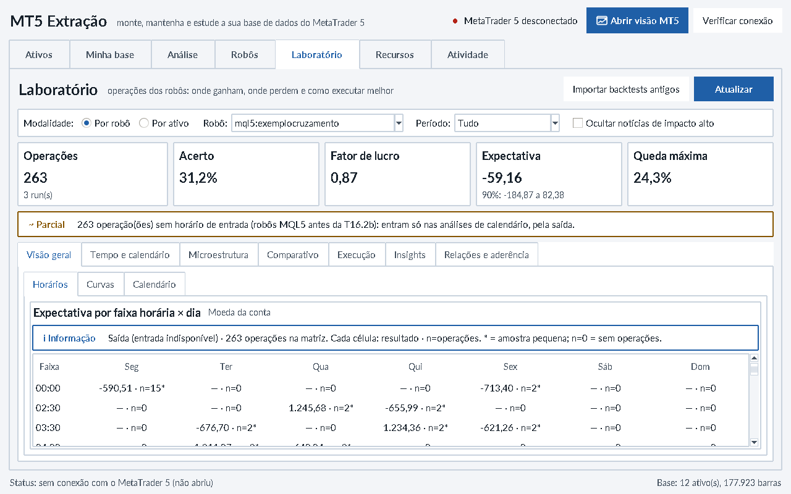
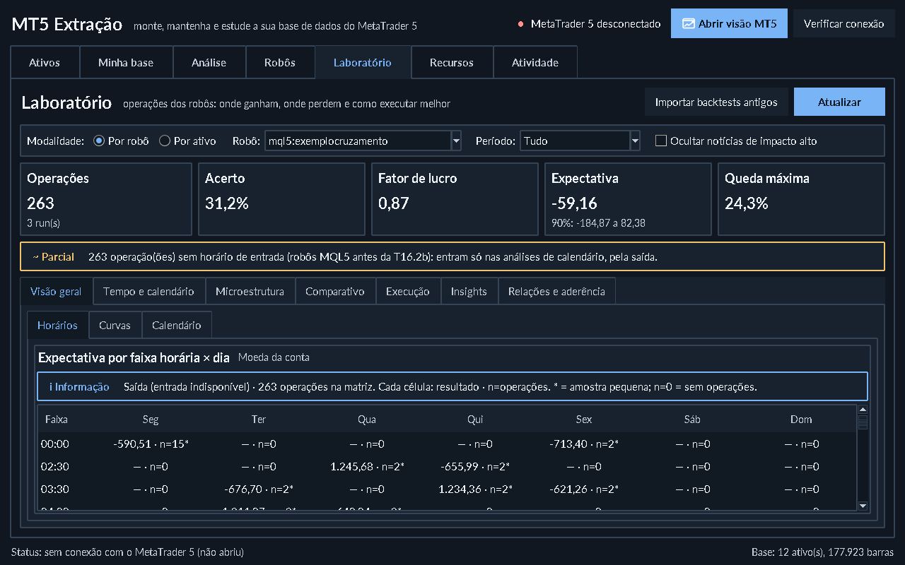
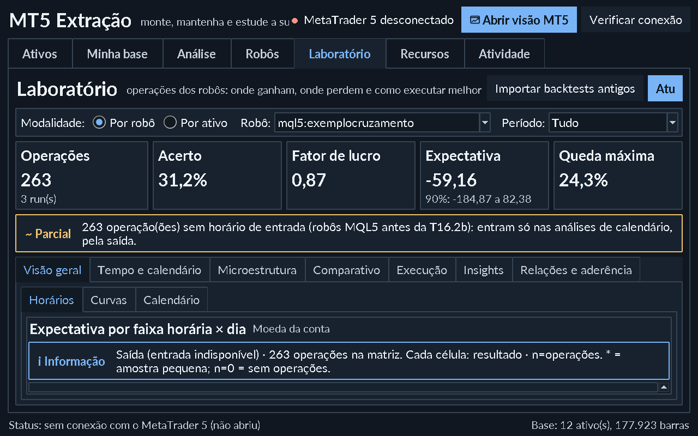
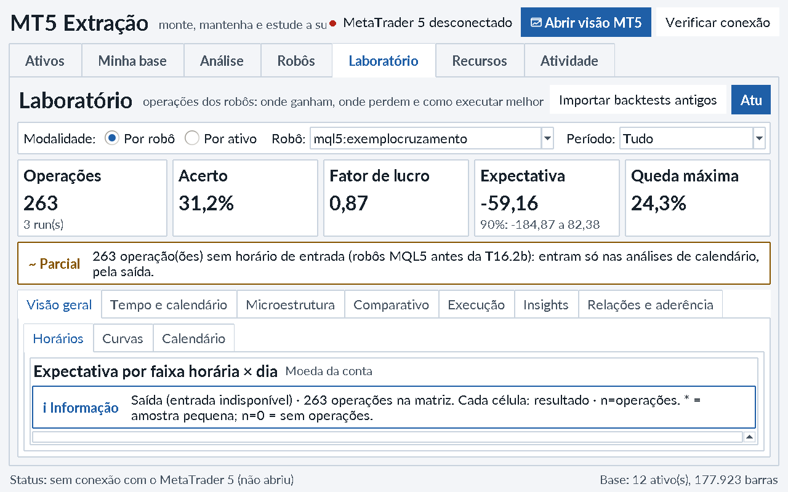
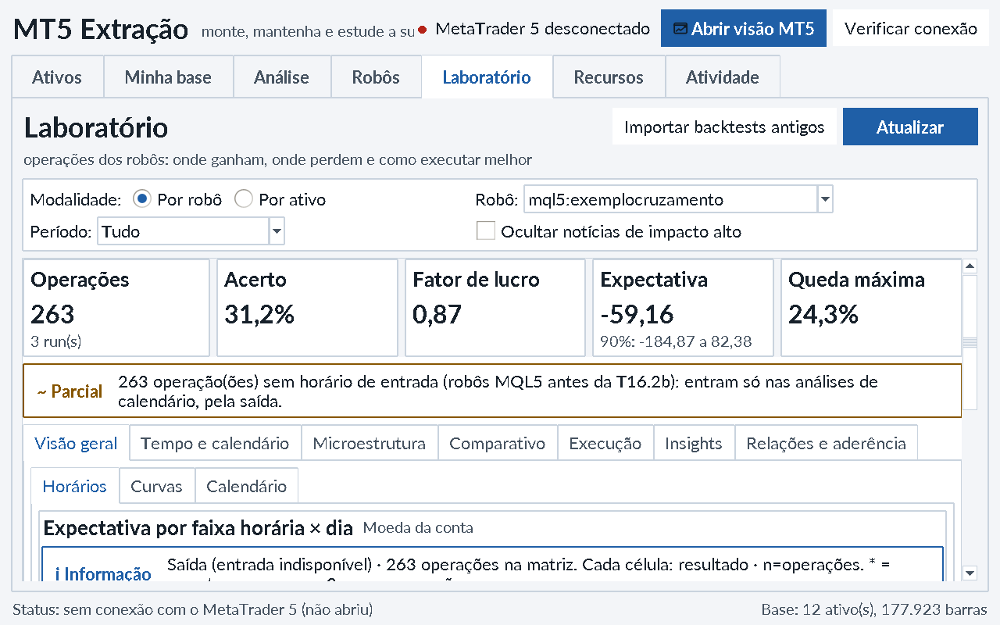
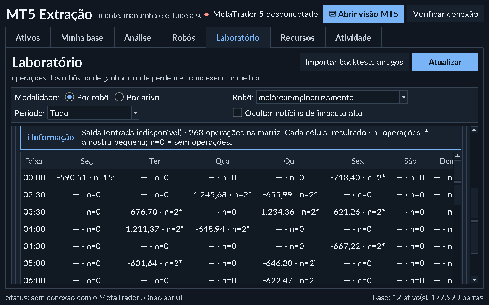

# Auditoria de análise no host — 2026-10-16

Prioridade do dono: concluir aceite visual antes da campanha PF ≥ 1,9. A campanha
permanece pendente. PRs #79/#80 seguem abertos em draft, sem revisão/merge autorizado.

## Método e limites

Aplicativo Tk real no Linux/Xvfb, código principal 7959fca e recorte T17.7 em worktree
isolada. Cópia SQLite consistente da base disponível: 12 ativos, 15 séries, 177923
barras. Terminal desativado; nenhuma operação em conta. A primeira inspeção do
launcher instalado consta do relatório anterior. Esta rodada usa a classe real
MT5Extracao, UIManager e componentes integrais; um driver privado aciona widgets
na thread principal e captura as janelas, sem substituir motores/dados.
Não equivale a validação Windows nem a uma campanha financeira.

A auditoria não terminou. Capturas iniciais feitas antes da conclusão da leitura
assíncrona foram descartadas como evidência de aceite; capturas verificadas exigem
263 operações carregadas. O processo anterior de inspeção atingiu timeout e foi
terminado; isso não prova um defeito de encerramento do aplicativo.

## Registro de problemas

| Tela → ação | Dificuldade → impacto | Proposta / tarefa | Estado / evidência |
|---|---|---|---|
| Laboratório → Horários de MQL5 antigo | “Entrada” com 263 saídas → interpretação temporal falsa | T17.7: referência e população explícitas | Corrigido em branch; capturas abaixo; integração pendente |
| Laboratório → seleção mista | Matriz exclui saídas; KPIs incluem todas → populações aparentemente iguais | T17.7: informar exclusão, mantendo seleção/cálculo | Teste completo/parcial/misto; dados reais disponíveis só parciais |
| Tempo → Dia da semana em 1280×800 | Rótulos negativos muito próximos do eixo; maior densidade com aviso → legibilidade reduzida | Novo recorte de altura/rolagem e margens dos gráficos | Aberto; não declarar aceite completo |
| Relações → Linha do tempo | Curva suavizada entre observações → contraria orientação atual | T17.8 proposto: retirar suavização, preservar pontos/lacunas | Aberto, preservar WIP T17.6 separadamente |
| Análise → Qualidade EURUSD H1 | Mensagem “prontos para estudo” sob sessão configurada 09:00–18:30 → alcance da cobertura pode ser superestimado | Explicitar alcance e origem do calendário; verificar dependência F13 | Aberto; zero lacunas nessa sessão não comprova cobertura total |

## Percursos exercitados nesta rodada

- Minha base: 12 ativos/15 séries, ordenação por ativo, seleção com teclado e exportação CSV
  pela ação da UI. 12405 linhas EURUSD H1 conferidas contra a base; integrity_check ok.
  O destino do diálogo foi fornecido pelo driver privado; não foi testada a escolha manual do arquivo.
  CLI `trades report` e os cinco KPIs da UI coincidem na precisão exibida para
  a mesma seleção antiga de 263 operações; isso não certifica custos completos.
- Análise: EURUSD H1, recorte de 1537 barras, Gráfico/Sazonalidade/Retornos/Qualidade.
  São dados de mercado, distintos de resultados do Expert.
- Laboratório: 263 operações parciais em três runs, as quatro visões temporais,
  Microestrutura, Comparativo (EURUSD H1/AGG M1), Execução e Insights nos estados
  disponíveis. Não foi criada evidência OOS nem executada busca financeira.
- Relações: cinco subvisões renderizadas com selo **DADOS SINTÉTICOS**.
  A integração T18.1/T18.6 permanece pendente. Captura anterior vazia após 1 s era inconclusiva.
- Robôs: catálogo real de 15 robôs e quatro abas de detalhes; Recursos: seis abas e
  medição, sem limpeza/arquivo/automação; medição grava retrato somente na cópia de auditoria.
- T17.7: claro/escuro em 1280×800 e 1920×1080, redesenho repetido sem duplicação
  da mensagem. Variação de scaling em processo existente é exploratória; DPI alto
  iniciado desde a criação do Tk foi validado depois: 143,86 DPI, scaling 1,998.
  Em 1280×800 há problema crítico: cabeçalho/botão Atualizar cortados, filtro de
  notícias fora da largura e tabela praticamente sem altura. T17.9 proposta para
  responsividade; aceite visual global NÃO concluído. Veja a captura abaixo.

Contraste medido, texto/superfície: claro ink 16,29:1, muted 5,14:1, accent 6,46:1;
escuro ink 14,39:1, muted 7,19:1, accent 7,41:1. Não é uma declaração de contraste
universal de todos os elementos/gráficos.

## Evidências T17.7

As métricas históricas exibidas são descritivas, com custos/completude limitados.
PF 0,87 visto na seleção antiga não é resultado de uma nova campanha ou holdout.

## Aceite ainda pendente

Concluir inspeção de diálogos/relatórios, reprodução de estudos, comparação justa
por preset/custos/moeda, zoom/exportação dos gráficos, vazios/erros/cancelamento,
janela reduzida/DPI alto/nomes longos/muitas séries e resolver os achados críticos.
Um recorte visual entregue não representa o aceite integral solicitado pelo dono.

## T17.9 — refinamento de responsividade

Baseline: 838 aprovados/9 ignorados em 697,62 s, saída 0, antes das alterações.
Ambiente instalado Linux sem MT5, Python 3.11.15. Branch empilhada sobre T17.7,
sem merge. Cabeçalho/filtros reorganizados pela largura real; seleção permanece
visível; KPIs, avisos e guias usam área rolável extraída do componente existente
de Relações. PageUp/PageDown no canvas com foco visível.

Primeira inspeção real após a implementação revelou aviso cortado e valores da
matriz largos demais para as colunas em DPI144. Corrigidos na segunda rodada:
quebra do aviso pela largura disponível, colunas pela fonte medida e rolagem
horizontal. Nenhum valor/contagem/preset/ordem/cálculo mudou.

Testes focados finais: **31 aprovados em 44,07 s**. Duas falhas iniciais nos testes
novos: posição inicial do canvas inclui borda de 1 pixel, e `orient` retorna objeto
Tcl em vez de string; corrigidas as expectativas de representação, preservando
a verificação de retorno à posição inicial e da barra horizontal. A suíte
completa posterior ainda precisa terminar. Doctor isolado: 15 OK/2 avisos/1 falha
(caminho MT5 deliberadamente vazio); principal permanece validado separadamente.
Windows real pendente. Não houve alteração shell.

A regra nova do dono para destacar positivos discretamente, atenuar negativos e
reduzir a atenção das ausências fica em T17.12 própria, reutilizando seletivamente
T17.6 preservada. Não se importa sua suavização. Aceite visual integral permanece
pendente das correções semânticas e dos percursos restantes.
