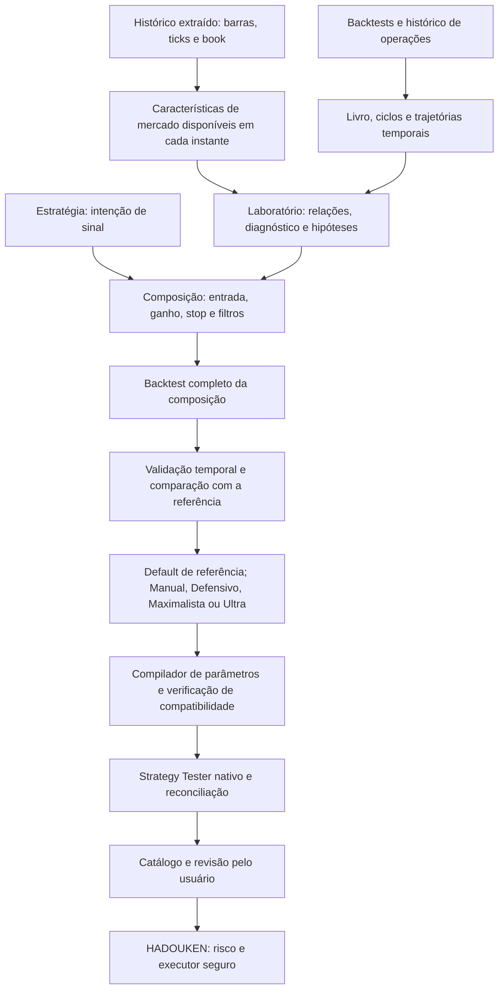

# F19 — Dados, operação, estratégias e geração de presets

**Registro documental de 2026-10-17, solicitado pelo proprietário. Implementação pendente.**
Esta especificação organiza a evolução do mt5x e sua integração com o HADOUKEN.
Não constitui resultado de backtest, aprovação financeira nem implementação dos módulos propostos.

Leitura em conjunto:
[catálogo completo](CATALOGO_F19_INDICADORES_SETUPS.md),
[plano de execução](PLANO_F19_PILARES_PRESETS.md),
[Analytics F13](../analytics/ESPECIFICACAO.md),
[Laboratório F16](ANALYTICS_OPERACOES.md),
[relações F18](RELACOES_INDICADORES_SETUP.md) e
[contrato SDK](../sdk/contrato.md).

**Qualificação transversal aceita em 2026-10-17:** a [F20](ROBUSTEZ_PESQUISA_EXECUCAO.md)
incorpora referências de cálculo/patrimônio flutuante, dados/experimentos reproduzíveis,
compatibilidade/economia/eventos, protocolo/ablação, pacote/evidências, acompanhamento,
recuperação, UI investigativa, recursos e conformidade/segurança/restore. Seus requisitos
Q01–Q16 ampliam estes mesmos pilares, sem motores/catálogos concorrentes. Conservar
as categorias, nomes, lotes/parciais, inversão e estudos completos desta especificação.
As [fichas T20.1–30](PLANO_F20_ROBUSTEZ.md) qualificam cada capacidade no momento necessário;
Manual simples não espera seleção automática, Ultra, carteira ou FRP.

## 1. Objetivo e vocabulário

Permitir estudar o mercado e as operações, montar uma composição operacional,
executar backtests reproduzíveis e produzir presets compatíveis com o Expert escolhido.
A composição deve atravessar Laboratório, CLI, catálogo, Strategy Tester e robô sem perder significado.

| Pilar | Subdivisões | Responsabilidade |
|---|---|---|
| Dados de mercado | OHLCV, ticks, book, indicadores e estatísticas | Enriquecer a base histórica extraída, com disponibilidade temporal e qualidade explícitas |
| Dados de operações | Backtest Python/MQL5, re-simulação, histórico demo/real | Medir resultados e trajetórias de trades/ciclos, incluindo eficiência temporal |
| Operacional | Entrada; orientação; gestão de lotes/exposição; realização parcial; ganho; stop/proteção; filtros | Definir como executar, dimensionar, reduzir e gerir uma intenção de negociação |
| Estratégico | Setups e suas regras objetivas | Definir por que, quando e em qual direção nasce o sinal |
| Presets | Default da estratégia; Manual; Defensivo; Maximalista (Fator de lucro); Ultra | Default primeiro, seguido das quatro categorias de trabalho; nomes padronizados e proveniência |
| UI transversal | Base, Análise, Laboratório e Robôs | Tornar essas escolhas compreensíveis, consistentes e acessíveis |
| Gestão da conta | Limites, orçamento, reserva e reconciliação | Frente posterior de robustecimento; integrar suas travas existentes |

**Gerador de presets** é a entrega central. Na solicitação, “gerador de backtest” também descreve
a automação que prepara e executa testes de composições. São duas responsabilidades:
o projeto já executa backtests; faltam a composição completa, sua avaliação automatizada e a
conversão verificável do resultado em preset. Não criar um segundo Strategy Tester.

“Tempo limite de trade” tem duas partes: uma medida descritiva no histórico de operações
e uma regra causal de saída. “Time de gain” e “time de loss” são configurações dessa regra;
não são indicadores de mercado calculáveis apenas com OHLCV sem uma operação de referência.

## 2. Estado conferido nesta base

**Reconciliação T19.1 (2026-10-17):** [inventário com SHAs, donos e consumidores](INVENTARIO_F19.md),
em revisão local. T13.2/T18.1 e produtores foram localizados em branches, sem integração
no HEAD inspecionado; o exportador isolado T17.28 já amplia os dados de sessões,
sem concluir o CSV permanente T16.2b-H nem o livro completo de eventos/ciclos.
O snapshot abaixo é histórico; o inventário discrimina essas situações.

Snapshot inicial: commit `489591c` (merge do PR #105). Leitura de código em 2026-10-17;
existência de arquivo não equivale a validação operacional.

| Superfície atual | Evidência local | Evolução necessária |
|---|---|---|
| Indicadores da extração | `indicator_calculator.py`, `advanced_indicators.py`, `enhanced_indicators.py` | Inventariar quais são efetivamente persistidos/exportados; consolidar fórmulas sem duplicação |
| Indicadores puros | `strategies/indicators.py`: SMA, EMA, ATR, RSI, ADX, Bollinger, Keltner, Donchian, ER, regressão e swings | Reutilizar e completar o catálogo; não considerar função existente como enriquecimento integrado |
| Analytics de mercado | `analytics/calendar.py`, `analytics/resampling.py` | Store/registry F13/F18 ainda não presentes nesta árvore; conferir integração antes de consumir |
| Livro e contexto de operações | `trade_analytics/ledger.py`, `enrich.py`, `cache.py`, `aggregate.py`, `stats.py` | Trajetória temporal, eventos de ciclo e contexto ampliado |
| Re-simulação | `trade_analytics/execution/engine.py`, `modes.py`, `runner.py` | Compor políticas independentes; re-simulação atual gere as entradas de um run |
| Tempo já disponível | `ExitPolicy.max_bars`, `ExitRules.max_bars` e saída por fim de dia | Acrescentar tempo condicionado a lucro/perda, eficiência, progresso e ATR |
| Lotes e parcial já disponíveis | `SymbolSpec.lots_for_risk`, `ExitRules.partial_r/partial_fraction` e motor de re-simulação | Dimensionamento por risco e parcial simples; re-simulador condiciona parcial a ausência de grid. Não confundir com plano geral de lotes/parciais múltiplas |
| Filtros e insights | `rules.py`, `insights.py` | Limites de frequência e filtros genéricos com semântica causal e reexecução |
| Exportação do Laboratório | `trade_analytics/export.py:proposal` | Hoje gera JSON de proposta; não compila a composição em um preset executável |
| Presets legados | `robots/mql.py`, `catalog.py`, `controls.py` | Leitura de .set já existe; falta compilador validado da composição |
| SDK/segurança | `robots/contract.py`, `robot.schema.json`, `battery.py`, `parity.py` | Declarar capacidades por versão; manter contrato 1 e travas |
| Robôs/TF na UI | `ui/robot_controls.py:SelectionDialog`, T17.28/PR105 | Timeframe já selecionável em “Ativo / TF”; verificar descoberta, propagação e regressões |
| Framework HADOUKEN | `Include/Framework/HADOUKEN/Strategies/HDK_StrategyRobot.mqh` | Motor atual usa `HDKSignal`/`HDKExitRules`; contratos B e Composer são backlog |

Os planos antigos conservam snapshots com estados diferentes. A tarefa T19.1 deve reconciliar
estado, commit e evidência antes de implementar; esta frente não marca T13.2, T18.1 ou os
contratos B como entregues. A referência `docs/analytics/T13.2_FEATURE_STORE.md` aparece na
continuidade histórica, mas o arquivo não está nesta árvore. Não tratá-lo como dependência disponível.

## 3. Arquitetura e propriedade



- mt5x é dono de extração, persistência, cálculo histórico, pesquisa, geração de artefatos e UI.
- HADOUKEN é dono do sinal MQL5, plano de execução, política de posição e integração com Safety.
- A biblioteca `mt5x-safety` distribui versões aprovadas da camada correspondente; alteração nela
  segue seu próprio fluxo, sem copiar mudanças silenciosamente.
- O sinal nunca envia ordem nem escolhe lote por fora do dimensionamento.
- Ordens MQL5 passam por `HDK_SafeExecutor` e guardas aplicáveis; Python continua sem envio de ordens.
- Composição usa o desenho B-01–B-11: `MarketContext`, `SignalIntent`, `ExecutionPlan`,
  `PositionPolicy`, `RiskDecision` e `ExecutionResult`. São contratos propostos no backlog,
  não APIs assumidas como prontas.
- Preferir adaptadores ao motor existente e preservar os seis robôs de referência e sua paridade.
- Os novos caminhos de módulos sugeridos no plano são propostas; confirmar os existentes antes de editar.

## 4. Contratos comuns de dados

### 4.1 Características do mercado

Toda definição precisa de ID estável, versão, fórmula, parâmetros, dependências, unidade,
aquecimento, origem/preço utilizado, tipo de volume, frequência de atualização e política de ausência.
Toda observação precisa de símbolo/contrato/corretora, timeframe/série, instante de referência,
`available_at`, revisão da fonte, versão do algoritmo e estado de qualidade.

A consulta para uma decisão em t só pode ver observações disponíveis até t.
O timestamp de abertura de uma barra não comprova que seu fechamento estava disponível.
Barras superiores, fractais, pivôs e séries transformadas exigem instante real de confirmação.
Guardar revisões sem reescrever o passado como se a informação sempre tivesse existido.

Reutilizar o store da T13.2 e registry da T18.1 quando integrados; não criar um store F19 paralelo.
F19 amplia definições, materializações e consumidores. Tabelas físicas só depois de inventário
e de confirmar os nomes canônicos; esquema sempre aditivo.
Views/exportações largas disponibilizam indicadores sem uma coluna física por combinação.

### 4.2 Operações e ciclos

Preservar `_trade_ledger` e suas chaves. Histórico de conta real, demo, Tester, Python e
re-simulação são origens distintas, nunca somadas como execuções equivalentes.

Distinguir sinal, ordem, preenchimento/deal, posição, operação e ciclo de gradiente.
Para estudos novos, ligar eventos por identidade estável: fonte, conta anonimizada, run,
robô/versão, composição/preset, ativo, direção, posição/ciclo e sequência.
Registrar custos conhecidos, moeda e conversões; ausência de custo não significa custo zero.
Não derivar entrada de um registro antigo que só tem saída.

Persistência proposta, apenas se não existir equivalente: trajetórias por operação/ciclo,
definições de composição, candidatos a preset, experimentos/tentativas e artefatos gerados.
A definição física e a política de retenção pertencem às tarefas de contrato; integrar F15.
Uma nova tabela por trade ou por parâmetro é inadequada.

### 4.3 Resultados e disponibilidade

Separar:
1. contexto disponível antes da entrada;
2. estado observável durante a posição;
3. desfechos conhecidos após seu fechamento.

MAE/MFE finais, duração total, lucro final e horário do melhor preço são desfechos.
Podem calibrar uma regra em treino; não podem filtrar a entrada da própria operação.
Operação ainda aberta é censurada, não perda ou zero. Falta de trajetória impede concluir
se um limite temporal teria encerrado com ganho, perda ou antes de um alvo.

Qualidade distingue dado ausente, aquecimento, aproximação, cobertura parcial e dado vencido.
Nenhum deles vira zero silenciosamente. Proxy de volume de ticks tem identificação própria;
não substituir agressão/negócios reais por OHLCV.

### 4.4 Estatísticas sobre a base histórica extraída

Além dos indicadores nomeados, reutilizar e completar F13/F18 para colunas calculadas
consumíveis por Análise, exportação e Laboratório:

| Família | Medidas e cuidados |
|---|---|
| Retorno/amplitude | Retornos por horizonte passado, gaps, range/true range, distribuição e quantis por janela |
| Volatilidade | ATR/ATR%, volatilidade histórica e percentis causais; janela e normalização declaradas |
| Volume/liquidez | Volume real ou de ticks identificado, RVOL por momento da sessão, quantis, spread e cobertura |
| Tendência/eficiência | Inclinação/R², ER, distâncias de média/canal e estados de regime com regra versionada |
| Tempo/calendário | Sessões, duração, pausas, dia/horário e sazonalidade com amostra/limitações da origem |
| Relações | Redundância/convergência e associação com alvos futuros via F18, com datas de maturidade próprias |

Uma estatística descritiva sobre todo o histórico não se torna feature disponível em cada
data passada. Publicar janela, n válido, versão, disponibilidade e estado; normalização e
limiares usados operacionalmente só usam passado/treino. Não chamar retorno futuro de feature.
T19.3 materializa e expõe as definições já existentes; cálculos novos mantêm os donos F13/F18,
com lacunas apontadas no inventário T19.1, sem criar motor estatístico concorrente.

## 5. Gestão temporal no Laboratório e na execução

### 5.1 Medidas a acrescentar ao histórico

Por trade e por ciclo: duração de relógio, tempo negociável da sessão, barras completas desde
a entrada, tempo até MFE e MAE, tempo até primeiro ganho/perda, tempo até limiares de R/pontos,
progresso favorável por barra e resultado ao longo da posição.
As séries de custo e PnL incluem parcial, swap e volume vigente quando disponíveis.
Definir “tempo até gain” como primeiro cruzamento de um limiar explícito, não lucro final.

Apresentar distribuições/quantis por ativo, TF, direção, estratégia, regime e preset;
curvas condicionais de continuação, risco e resultado por idade da operação; n em risco,
censura, intervalos de confiança e cobertura em cada ponto.
A frase do estudo “80% dos vencedores atingem até a 8ª barra” não determina a probabilidade
de uma operação sobrevivente vencer depois: faltam os demais trades e o condicionamento.
Estimar com a população completa; não incorporar essa probabilidade como fato.

### 5.2 Políticas causais propostas

| Política | Parâmetros e condição observável |
|---|---|
| Limite absoluto | Máximo de barras/minutos; encerrar independentemente do PnL |
| Limite por falta de progresso | Idade ≥ N e PnL abaixo do mínimo configurado |
| Time de gain | Prazo próprio para operação com ganho líquido observável; realização no prazo ou após perder progresso definido |
| Time de loss | Prazo próprio se resultado ≤ limiar de perda/empate; não esperar o stop físico para sempre |
| Tempo + ER | Idade mínima e ER abaixo do limiar calculado só com dados já observáveis |
| Tempo + MFE/MAE parcial | Progresso acumulado até agora, sem usar o extremo que virá depois |
| Tempo + Donchian | Prazo sem renovar extremo e retorno ao canal de referência |
| Tempo adaptado ao ATR | Horizonte de referência escalado por ATR relativo causal, com limites mínimo/máximo |

O estudo também cita relógio volumétrico ou por amplitude. Registrar essas variantes no
contrato, com limiar de volume/amplitude, origem e reset, sem tratá-las como minutos.
Primeiro entregar o ajuste por ATR; as demais variantes só são habilitadas quando a fonte
e a regra de contagem forem qualificadas. Ausência de negócios não autoriza converter
tick-volume em volume financeiro sem mudar a identificação da variante.

Exemplo de referência do estudo: 15 barras e lucro inferior a 50 pontos. Não é default
aprovado; ponto depende do ativo e minuto não equivale a barra em Renko.
Para a variante adaptativa, testar proposta `N = clamp(N0 * ATR_ref / ATR_atual, Nmin, Nmax)`;
fixar no contrato quando atualizar o prazo e proibir extensão indefinida após perda.
As regras de ganho e perda têm limiares com cobertura explícita da região de empate.

Definir barra da entrada, primeiro instante de avaliação, igualdade no limite, fuso,
pausas, fim de sessão, gaps, reinício, custos e estado nulo.
O relógio nasce no preenchimento, não na emissão da ordem.
Adições/parciais não reiniciam automaticamente a idade do ciclo.
Escolher na composição se conta tempo por perna, posição ou ciclo e impedir ambiguidades.

Manter stop protetor obrigatório. Uma saída temporal a mercado não o substitui.
No simulador, atualização calculada no fechamento só vale a partir do próximo evento
executável; não preencher retroativamente em um preço intrabarra já ocorrido.

## 6. Composição operacional

A UI e o preset representam blocos independentes. A antiga opção “ponto fixo (base)” é
a referência do run, não um tipo universal que mistura entrada, stop e alvo.

| Bloco | Catálogo inicial obrigatório | Configuração mínima |
|---|---|---|
| Entrada | Simples a mercado; nível fixo; Fibonacci; limite; rompimento stop; reteste; gradiente fixo/dinâmico contra; gradiente direcional a favor | Preço/referência, âncoras, validade, cancelamento, distância, níveis, lote e exposição |
| Orientação do sinal | Normal; inversão experimental compra↔venda | Flag desligada por padrão; direção original/efetiva e política de níveis |
| Ganho | Alvo fixo em pontos/%/R; ATR; média/VWAP/canal; Fibonacci; parcial; saída por sinal; tempo de gain | Fonte e atualização do alvo, âncoras, frações, prioridade |
| Stop | Fixo; ATR inicial; trailing fixo/ATR; mínima/máxima de N barras; média; High-Low; break-even; tempo de loss | Offset, ativação, atualização, trava de avanço e proteção mínima |
| Filtros | Horário; dia; notícias; quantidade diária; cooldown; indicador/regime; direção; spread/qualidade | Liga/desliga explícito, condição, intervalo, fuso e comportamento sem dado |
| Gestão de lotes e exposição | Quantidade fixa; dimensionamento por risco; entrada com mais de um lote; adições suportadas | Unidade do ativo, mínimo/passo/máximo, risco/margem, volume por entrada/posição/ciclo e tetos |
| Realização parcial | Uma ou várias reduções por quantidade/% e gatilho declarado | Base do percentual, etapas/IDs, volume a fechar/remanescente, proteção e tratamento do lote indivisível |

**Gradientes:** direção e espaçamento são escolhas distintas. Combinar a favor/contra com
pontos/ATR, stop variável e filtros de horário/dia só se a capacidade do robô admitir.
Declarar risco de todas as ordens potenciais, margem, stop global/ciclo, expiração,
recuperação e reserva de pendentes. Um fator de lote não deve mudar de significado entre
“constante por nível”, “progressão aditiva” e “multiplicação por nível”.
Não presumir que o atual `grid_lot_factor` implementa toda progressão descrita no estudo.

**Alvos Fibonacci:** declarar pivôs já confirmados, direção, intervalo de referência,
retração/extensão, níveis, regra de ancoragem e congelamento/atualização.
Não usar máxima/mínima futura do período de teste para posicionar o alvo.
O mesmo cálculo de níveis pode referenciar **entradas Fibonacci**, com tipo de ordem,
gatilho, validade e âncoras declarados; alvo e entrada continuam funções distintas.

**Stop variável:** distinguir stop inicial derivado de indicador e trailing.
Stops protetores nunca se afastam para aumentar risco sem uma política formal que permita
e seja validada; a proposta inicial usa trava de avanço. Meta móvel tem sua própria regra,
não precisa compartilhar a semântica do stop.

**Filtros:** configurar múltiplas janelas permitidas/excluídas, dias e limite 1/3/N ciclos
por sessão; atribuir dia por calendário/fuso, inclusive janelas que cruzam meia-noite.
Definir AND/OR com agrupamento explícito, nunca dependente da ordem dos widgets.
A primeira versão aceita grupos tipados simples, sem execução de expressão livre.
Notícia futura só pode usar agenda conhecida naquele instante; surpresa só após publicação.

Contar preenchimentos de novas operações/ciclos, não cliques ou cada nível do gradiente.
Documentar reversões, rejeições, cancelamentos, parciais, reconexão e consumo de cota.
Filtro de entrada não bloqueia proteção/fechamento de uma posição existente.
Fora da janela: cancelar pendentes conforme política; encerramento forçado é escolha separada.
Estado ausente nunca autoriza implicitamente uma nova entrada dependente dele.

### 6.1 Conflitos e ordenação

O contrato fixa precedência de eventos e desempate: bloqueios de risco e proteção,
execuções já ocorridas, stops/alvos válidos, parciais e regras de fechamento.
Respeitar a ordem conservadora atual em OHLC (stop antes do alvo quando ambos cabem).
Saídas calculadas no fechamento competem por regra determinística e motivo auditável.
Combinações inválidas são recusadas antes do teste; não desligar regras silenciosamente.

Reversão é fechamento confirmado seguido de nova intenção sujeita a filtros e risco;
em netting/hedging, conciliar volume residual e falha da segunda etapa.
Um sinal contrário não pode contornar limite diário ou stop obrigatório.

### 6.2 Inversão experimental do sinal de entrada

Adicionar `orientation.invert_entry_signal: false` à composição proposta, com opção visível
**Inverter sinal de entrada (experimental)**. O usuário pode flagar e comparar:
compra original → intenção de venda; venda original → intenção de compra;
sem sinal continua sem sinal. Aplicar uma única vez, depois do sinal estratégico e antes
do planejamento da entrada; filtros direcionais e risco avaliam a direção efetiva.

Esta transformação não significa fechar/inverter automaticamente uma posição aberta.
A reversão descrita em 6.1 e S11 tem sua própria política de posição. Também não inverter
sinais de saída, critérios de risco ou permissões por causa dessa flag.

Recalcular preço, lado bid/ask, stop, alvo, volume e ordem pendente para a nova direção.
Distância em pontos/R pode ser preservada se essa transformação estiver declarada;
nível estrutural/Fibonacci não deve ser refletido ou trocado silenciosamente.
Um Buy Stop invertido não vira Sell Stop no mesmo preço sem validar o tipo/nível:
o módulo declara o plano correspondente ou recusa a composição como não suportada.
Não trocar SL com TP nem multiplicar o PnL antigo por −1 para simular a inversão.

Gravar sinal original, direção efetiva, flag, regra ativa e versão em preset/run/eventos.
Normal e invertido têm identidade, custos e backtest completo próprios; comparar no mesmo
período/modelo de custos/risco, sem herdar a evidência do modo normal. Oferecer exploração
manual mesmo sem expectativa de melhora, mantendo rascunho/estado experimental e travas.
Se entrar na busca automática/Ultra, contar como alternativa testada e exigir os mesmos gates.
Flag desligada reproduz o comportamento anterior; nenhum Expert sem suporte recebe um .set
que pareça inverter mas ignore a opção. Implementação: T19.51.

### 6.3 Gestão de lotes, múltiplos volumes e saídas parciais

Requisito explícito do pilar operacional, aplicável a Default e às quatro categorias de
trabalho. Não adiar o dimensionamento/gerenciamento local para a futura gestão global
da conta; consumir desde já seus limites/guardas existentes quando necessários.

#### 6.3.1 Conceitos e dimensionamento

| Conceito | Significado e configuração |
|---|---|
| Volume da entrada | Uma ordem pode abrir quantidade maior que um lote/contrato, conforme unidade e limites do ativo |
| Entradas adicionais | Novos preenchimentos no mesmo plano/ciclo; distintos de abrir uma única ordem com maior volume |
| Posição/ciclo | Volume consolidado e/ou contribuições por perna, com ownership e regra de atribuição |
| Saída parcial | Reduzir a exposição existente; não é automaticamente nova operação nem reversão |
| Quantidade fixa | Usuário informa volume, sujeito a especificação, risco, margem e tetos; não contorna guardas |
| Por risco | Calcular volume permitido por orçamento, stop efetivo, especificação e custos considerados |

Rotular unidade explicitamente: lote MT5, contrato ou unidade negociável não são
intercambiáveis entre ativos. Usar SymbolSpec/metadados reais do símbolo, incluindo
volume mínimo/passo/máximo e valor do tick/contrato; não fixar lote 1, 0,01 ou duas casas.

Normalizar para um volume válido sem aumentar o risco aprovado. Entrada abaixo do mínimo
é recusada/pulada com motivo; quantidade fixa acima do teto é recusada ou reduzida apenas
por política declarada e exibida. Custo/risco modelado não garante preenchimento em stop
sem gap: preservar o modelo de execução e suas limitações.

Antes do envio, mostrar volume solicitado/efetivo, perda modelada no stop, margem e teto
da posição/ciclo. Para adições/gradiente, incluir ordens pendentes e todos os níveis
potenciais no orçamento/reserva aplicável. Usar lote constante, progressão ou piramidação
somente quando declarados, suportados e permitidos; não introduzir martingale implícito.

#### 6.3.2 Plano de realização parcial

Configurar lista ordenada de etapas, sem limitar o projeto a uma única parcial de 50%:

- ID estável, gatilho e parâmetros: preço/pontos/R, indicador/sinal ou tempo suportado.
- Quantidade absoluta ou fração, com base declarada: volume inicial ou saldo no gatilho.
- Âmbito: posição, perna identificada ou ciclo; prioridade de preenchimento/atribuição.
- Ação após confirmação: manter stop, ativar break-even/trailing ou outra regra suportada.
- Encerramento do saldo: alvo final, stop, trailing, tempo, sinal ou fim de sessão.

Exemplos aritméticos de QA, sem parâmetros operacionais aprovados:

| Especificação hipotética | Plano de volumes | Resultado esperado |
|---|---|---|
| Quantidade inteira, mínimo/passo 1 | Entrada 3; parcial 1; parcial 1; fechamento final 1 | Saldos 3→2→1→0, sem nova entrada ou posição inversa |
| Mínimo/passo 0,10 lote | Entrada 0,30; reduções de 0,10 | Saldos 0,30→0,20→0,10→0, sem erro acumulado |
| Quantidade inteira, mínimo/passo 1 | Entrada 1; pedido de parcial de 50% | Parcial inviável; não executar volume zero nem ampliar fechamento silenciosamente |

Validar a agenda antes do teste/envio. Percentuais sobre o inicial não podem exceder
100%; percentuais sobre o saldo são sequenciais e têm significado diferente. Volumes
absolutos nunca podem fechar mais que a quantidade disponível. Quantizar cada redução e
o saldo segundo o símbolo, sem frações inválidas ou resíduos abaixo do mínimo.

Se uma etapa for inviável, a primeira versão a marca como não executável/ignorada com motivo,
preservando o saldo e sua proteção; fechamento integral substituto só se explicitamente
configurado. Não alterar volume, percentual ou significado de uma etapa sem informar.
Mudança de stop após parcial depende de redução confirmada, não apenas do gatilho/preço.

Etapas com gatilhos simultâneos têm precedência definida; em OHLC manter a ordem conservadora
de stop antes de parcial/alvo quando a sequência real não for conhecida. Gaps, rejeições,
preenchimentos parciais da própria ordem e slippage usam o modelo/camada de execução comum.

Cada etapa tem estado: aguardando, solicitada, parcialmente preenchida, concluída,
recusada/cancelada. Marcar conclusão pela execução confirmada e reconciliada. Deduplicar
eventos e recuperar estado ao reiniciar para não repetir a parcial a cada tick/reconexão.

#### 6.3.3 Integração com múltiplas entradas e proteção

Parciais simples, múltiplas e sobre gradiente são capacidades distintas no contrato.
Para adições, definir se o plano usa volume inicial, lote semente, saldo corrente ou volume
planejado do ciclo. Não reiniciar a agenda/etapas automaticamente por uma nova adição.
O gatilho em R informa referência de risco/preço congelada e regras de eventual preço médio;
não recalcular retrospectivamente R para melhorar as métricas.

Em hedging, mapear tickets/volumes próprios; em netting, conciliar contribuição e redução
da posição consolidada pelo caminho suportado. Fechamento não pode criar posição oposta,
atingir operações de terceiros ou alegar gestão por perna sem atribuição verificável.

Manter proteção do saldo após cada execução, atualizar alvos/pendentes conflitantes e
limites de exposição. Reduzir volume não autoriza reentrada automática nem reutilizar
orçamento reservado sem a política de risco aplicável. Tempo/cota do ciclo não são zerados.

#### 6.3.4 Dados, cálculos, preset, UI e testes

Registrar volume solicitado/preenchido, adicionado, reduzido e aberto por evento/etapa,
preço, custos, resultado realizado, saldo, stop vigente e vínculo à posição/ciclo.
Conciliar: volume aberto = preenchimentos de entrada − preenchimentos de saída,
considerando somente os eventos próprios e o escopo definido.

Separar resultados realizados/parciais e marcação do saldo aberto. Comissão, swap e demais
custos seguem volume e tempo reais/modelados de cada exposição, sem dupla cobrança ou omissão.
Somar o resultado líquido das pernas para o trade/ciclo; um trade com duas parciais não vira
três trades vencedores no cálculo de acerto/PF. Contagem de deals/execuções fica separada.

Schema/preset devem transportar política de lote, unidade, orçamento/tetos, agenda de
parciais, gatilhos, base percentual, saldo final e proteção posterior. Expert sem suporte
recusa a composição, em vez de omitir a agenda. Preservar a parcial simples legada via
adaptador, sem inventar que o re-simulador atual já suporta parcial com grid.

UI ganha grupo **Lotes e parciais**, com modo fixo/risco, volume efetivo, prévia da exposição,
editor de etapas, parcelas/saldo e alertas de inviabilidade. Valor, percentual e unidade
devem estar claros; edição revalida a soma e a proteção. Default continua como referência;
nome do Manual e regras Ultra não mudam a semântica da política de volume.

Testar contas aritméticas conhecidas, mínimo/passo, arredondamento, saldo, custos e métricas
na estrutura/backtest; observar entrada com volume >1 e parciais no MT5 nativo por replay
ou DEMO conforme a matriz. Cobrir buy/sell, grid aplicável, saldo mínimo, rejeição,
execução parcial, reinício/duplicata, netting/hedging suportados e conflito stop/alvo.
Implementação: T19.56 (lotes/exposição) e T19.57 (parciais), ampliando módulos existentes.

## 7. Re-simulação, backtest completo e evidência

Re-simulação responde como as MESMAS entradas observadas se comportariam com outra gestão.
Não recupera sinais que o robô não emitiu/registrou.
Filtrar o ledger ou trocar seu PnL é análise contrafactual, com a limitação exposta.

Backtest completo reexecuta sinal, filtros, entrada, dimensionamento, posição e capital
em sequência. É obrigatório quando uma mudança pode alterar sinais seguintes, tempo
ocupado, frequência, capital, margem, lote, ordens simultâneas ou oportunidades.
Inclui limites de operações/dia e novos tempos de saída, mesmo que o sinal original seja o mesmo.
A comparação mostra baseline, re-simulação e execução completa como resultados distintos.

Reutilizar `strategies/backtester.py`, `robots/backtest.py`, `robots/sessions.py`,
lotes/matriz, importadores e ledger. O motor de composição deve conservar a paridade
do comportamento antigo quando os módulos novos estão desligados.

Avaliar custos/spread/slippage/swap, lotes, margem, exposição, gaps e ambiguidade intrabarra;
qualidade e moeda acompanham cada métrica. Contar tentativa mesmo quando falha ou é descartada.
Amostras de runs repetidos/sobrepostos não se tornam observações independentes.

## 8. Gerador de presets

### 8.1 Fluxo e perfis

1. Escolher robô/versão, ativo/corretora/contrato, timeframe/série e período.
2. Escolher composição manual ou orçamento de busca automatizada.
3. Validar suporte, parâmetros, dados e tetos antes de alocar testes.
4. Executar e registrar candidatos, inclusive falhas/rejeitados.
5. Selecionar só com treino e validação cronológica; congelar candidatos.
6. Conferir reserva final uma vez para o protocolo registrado.
7. Gerar pacote de preset e evidência com estado explícito.
8. Verificar ida e volta de parâmetros, backtest nativo e reconciliação da composição.
9. Disponibilizar no catálogo; ativação mantém o fluxo operacional existente.

| Perfil | Regra de seleção proposta |
|---|---|
| Default | Primeiro preset da estratégia; retrato versionado dos parâmetros padrão efetivos, sem otimização |
| Manual | Usuário escolhe nome e valores; pode salvar rascunho sem evidência. “Manual” não significa validado |
| Defensivo | Entre candidatos elegíveis, minimizar drawdown de equity marcada a mercado sob custos adversos; desempatar por cauda/CVaR, recuperação, exposição e estabilidade |
| Maximalista (Fator de lucro) | Entre candidatos elegíveis, maximizar PF líquido finito na validação; desempatar por estabilidade, intervalo/expectativa e menor risco |
| Ultra | Compor regras condicionais de calendário/mercado para escolher entradas, ganhos, stops e filtros suportados; buscar maior resultado líquido sob limites de risco e validar a política inteira (§8.5) |

O Default é a referência inicial; as quatro categorias de trabalho continuam Manual,
Defensivo, Maximalista e Ultra. “Maximalista” é o nome de apresentação da categoria que
maximiza fator de lucro, mantendo token/ID `FatorLucro` e aceitando o rótulo anterior;
não criar uma categoria duplicada ou trocar seu objetivo silenciosamente.

Objetivos, desempates e limiares têm versão e são exibidos antes da busca.
Defensivo não pode escolher “não operar” ou eliminar quase todas as operações como vencedor.
Elegibilidade exige amostra/sessões e atividade mínimas, dados e custos suficientes,
expectativa líquida e risco dentro dos critérios configurados, estabilidade temporal,
sem violação de limites. Limiares numéricos serão definidos no protocolo antes de testar,
sem flexibilizar bateria/Filtro C. Se não houver candidato elegível, retornar “nenhum candidato”.

PF preserva o contrato T13.9: sem denominador/perdas, vazio ou inválido = null com motivo;
não usar infinito, 99/999 ou uma operação vencedora como campeão.
Não ranquear carteiras com moedas/capital/risco/períodos diferentes sem normalização declarada.
Se equity intratrade não existe, mostrar drawdown de saldo como aproximação e impedir
rotulá-lo de melhor risco operacional comprovado.

Walk-forward com separação temporal, maturidade dos rótulos, purging/embargo e controle de
múltiplas tentativas. Busca de limiares, indicador e combinações ocorre só no treino.
Reprovação na reserva não autoriza reotimizar nessa mesma reserva e chamá-la de independente.
Alterar objetivo ou orçamento cria novo protocolo e registra o uso anterior dos dados.
T18.7 fornece candidatos de pesquisa; F19 verifica executabilidade e os transforma em artefatos.

### 8.2 Pacote, compatibilidade e estados

Proposta de pacote: arquivo canônico de composição + manifesto de evidência + .set específico
do Expert + configuração do teste. Separar metadados dos inputs que o MT5 realmente lê.
Nenhum arquivo novo é considerado instalado/ativado apenas por ser gerado.

O manifesto inclui versões/schema, robô e fingerprint de código/includes/Safety,
capacidades e mapeamento tipado para inputs, parâmetros efetivos, composição/hash,
fonte/scope dos dados, revisões, custos/moeda/capital, séries/TFs, período,
protocolo/folds/tentativas/semente, métricas e motivos de ausência, limitações,
validações de compatibilidade, artefatos/hashes e instante de geração.

`robot.schema.json` v1 rejeita campos desconhecidos: não acrescentar “capabilities”
nele informalmente. Definir sidecar versionado ou migração formal conforme B-11.
Contrato 1 e .set antigos continuam legíveis. Robô antigo exporta apenas papéis
mapeados e comprovados; bloco incompatível impede gerar .set e explica o motivo.

Testar bool/enums/números/unidades, UTF-8/UTF-16 legados, precisão, defaults efetivos,
precedência de perfis internos e leitura de volta. Input desconhecido, obrigatório ausente
ou módulo que o Expert ignora é erro; não omitir para “fazer funcionar”.
Timeframe do gráfico/teste e eventual input interno têm precedência declarada e conferida.

Estados separados:
- rascunho e compatibilidade técnica (completo/incompatível);
- evidência (exploratório, validado OOS, insuficiente, reprovado, vencido);
- autorização operacional (conforme regras existentes, por conta/contexto).

A confirmação demo negativa da T17.28 continua com seu significado atual; a geração de
preset não reescreve esse fluxo nem promove evidência insuficiente a aprovação estatística.
Alteração de ativo, timeframe, código, Safety, dados relevantes ou valores efetivos invalida
a evidência correspondente; editar arquivo não herda a aprovação anterior.
Arquivos existentes são preservados; gravação atômica e versionada, sem segredos/caminhos pessoais.

### 8.3 Estrutura mínima de intercâmbio (proposta, não API atual)

O schema definitivo é entregue em T19.2/T19.25. A composição canônica separa os seguintes
campos; o compilador transforma somente os campos operacionais suportados em inputs .set:

| Campo lógico | Conteúdo obrigatório quando aplicável |
|---|---|
| schema_version / composition_id / revision | Identidade e versão do formato/composição |
| strategy | ID/versão da regra de sinal e parâmetros |
| preset_category / naming_version | Default, Manual, Defensivo, FatorLucro ou Ultra; versão da convenção de nomes |
| user_name / name_slug / canonical_name | Nome escolhido pelo usuário no Manual, token portável e nome de arquivo emitido; separados de preset_id |
| orientation | Flag normal/invertida; no Ultra, escolhas por regra e orientação padrão explícitas |
| series | TF de sinal/contexto/execução ou especificação Renko e fonte |
| entry | Tipo, referência/preço, validade, níveis e política de preenchimento |
| profit_exit | Tipo de ganho, âncoras/indicador, parâmetros e parciais |
| protection | Stop inicial, trailing, break-even e política temporal |
| filters | Grupos tipados, intervalos/dias/frequência e política para dado ausente |
| sizing | Modo fixo/risco, unidade, volume solicitado/efetivo, risco local/ciclo, adições/tetos e limites vigentes |
| partial_exit_plan | Etapas/IDs/gatilhos, quantidade/fração e sua base, âmbito, saldo final, proteção posterior e política de inviabilidade |
| execution_order | Precedência e versão da regra de conflito entre eventos |
| conditional_policy | Regras/prioridades/alternativa padrão/transições do Ultra, quando aplicável |
| target_robot | Identidade/código/Safety e capacidades/mapeamentos exigidos |
| experiment_ref | Protocolo, contexto e referências de evidência, sem misturar com inputs |

O preset manual sem experimento mantém estado de rascunho. Editar um campo semântico
altera a identidade efetiva e invalida os resultados anteriores que dependiam dele.
Datas de geração e caminhos de saída não mudam o hash semântico da composição.
Não salvar senha, login pessoal ou caminho do host no pacote portável.

### 8.4 Nomes padronizados e identidade dos presets

**Obrigatório no Default e nas quatro categorias de trabalho**, na UI e em arquivos/relatórios.
Nome legível proposto: `Donchian · EURUSD · H1 · Ultra · Normal · v001`.
Arquivo correspondente:

```text
<Robo>__<Ativo>__<Serie>__<Categoria>__<Orientacao>__v<NNN>__<HashCurto>.set
Donchian__EURUSD__H1__Default__Normal__v001__f19a2b3c.set
Donchian__EURUSD__H1__Manual__Abertura-Europeia__Normal__v001__7a3c91d2.set
Donchian__EURUSD__H1__Defensivo__Normal__v001__85d4c2a1.set
Donchian__EURUSD__H1__FatorLucro__Invertido__v001__32c9f7a4.set
Donchian__EURUSD__H1__Ultra__Condicional__v001__a6d8b2c5.set
```

Os hashes dos exemplos são ilustrativos, sem arquivos/presets gerados nesta entrega.

| Elemento | Convenção |
|---|---|
| Robô | Nome curto estável do catálogo; identidade completa/versão no manifesto |
| Ativo | Símbolo legível normalizado; símbolo original, corretora e contrato preservados no manifesto |
| Série | M1/M5/H1 etc.; Renko usa rótulo próprio com tamanho/unidade, sem TF fictício |
| Categoria | Tokens fixos `Default`, `Manual`, `Defensivo`, `FatorLucro`, `Ultra`; UI exibe “Maximalista (Fator de lucro)” para FatorLucro |
| Nome do usuário | No Manual, inserir `__<NomeUsuario>` após a categoria; preservar texto original no manifesto e usar slug portável no arquivo |
| Orientação | `Normal`, `Invertido` ou `Condicional`; último apenas quando regras Ultra realmente variam a orientação |
| Versão | Revisão do preset, preenchida com no mínimo três dígitos; mudanças semânticas geram nova revisão |
| Hash curto | Prefixo mínimo de oito caracteres da identidade efetiva; ampliar em colisão |

Nome não substitui `preset_id`, composição/hash completo nem escopo do manifesto.
Identidade efetiva inclui categoria/objetivo, robô/versão, escopo, orientação e regras/valores
que alteram decisões; manter o hash de configuração separado do hash de evidência/artefatos.
Data da exportação, pasta, apelido de exibição e métricas de performance não mudam a
identidade semântica. Reexportar a mesma identidade/revisão conserva nome, sem sobrescrever
artefato diferente; atualizar evidência tem revisão própria e rastreável.
Dois Manuais criados com nomes distintos podem compartilhar config_hash e ter preset_id
diferentes; não deduplicar a escolha do usuário apenas pela igualdade de parâmetros.
O identificador usado no hash do arquivo inclui preset_id, distinguindo presets diferentes;
config_hash continua separado para comparação dos mesmos parâmetros.

Normalizar de forma determinística para nomes de arquivo portáveis: sem acentos/espaços,
separadores de caminho ou caracteres proibidos; evitar nomes reservados, ponto/espaço final,
colisão por maiúsculas/minúsculas e excesso de comprimento no Windows. Limitar o nome-base
a 180 caracteres ASCII, preservando categoria, orientação, revisão e hash; abreviar apenas
tokens legíveis por regra estável. Símbolos diferentes que normalizam igual permanecem
distintos pelo ID/hash e símbolo original no manifesto. Hash curto nunca é chave única.

Não incluir “lucro garantido”, ranking ou PF observado nos nomes automáticos. Categoria Ultra
identifica o método, não prova que superou as demais. Nome do Manual é entrada do usuário,
não metadado de evidência ou critério de aprovação, independentemente de seu texto.
Presets legados permanecem aceitos com seus nomes atuais; não renomear arquivos do usuário.
T19.50 implementa a convenção no Default, nos quatro fluxos, no compilador, catálogo e exports.

#### 8.4.1 Preset Manual com nome escolhido pelo usuário

O editor precisa de campo visível **Nome do preset**, obrigatório ao salvar um Manual,
com exemplo/prévia do rótulo e do nome de arquivo. Permitir nome legível de 1–80 caracteres
após trim/normalização Unicode, mantendo acentos no rótulo; gerar slug seguro separadamente.
Não limitar a liberdade do usuário a um apelido que desaparece ao exportar/importar.

Exemplo: nome informado “Abertura Europeia”; rótulo:
`Donchian · EURUSD · H1 · Manual · Abertura Europeia · Normal · v001`.
Arquivo conforme o exemplo acima. O nome original acompanha manifesto, catálogo, relatórios
e round-trip; a identificação automática usa campos tipados/ID, não tenta inferir parâmetros
ou categoria só pela leitura do nome livre.

Nomes vazios ou sem slug utilizável são recusados com correção amigável. Detectar duplicata
de nome normalizado no mesmo robô/escopo e oferecer nova revisão da mesma identidade ou
outro nome, sem sobrescrever um preset diferente. Case/acento e slug colidentes têm tratamento
determinístico; IDs/hashes continuam diferenciando identidades.

O slug/nome canônico é fixado na criação daquela revisão. Renomear a apresentação depois
preserva ID, parâmetros, evidência válida e arquivos históricos; exportações da revisão
conservam seu nome canônico e metadados atualizados, sem renomeação automática do legado.
Mudança de parâmetro gera revisão/validação próprias. UI e CLI usam o mesmo serviço de nomes.
Entregas T19.26/T19.50; regras completas de round-trip incluem user_name e name_slug.

#### 8.4.2 Default da estratégia: primeiro preset do sistema

Para cada estratégia/versão, o catálogo oferece **Default** como primeiro item, antes de
Manual/Defensivo/Maximalista/Ultra, mesmo em busca/ordenação por categoria. É um preset
explícito de referência, derivado dos valores padrão efetivos da estratégia/Expert e do
perfil interno aplicável, com origem/hash, versão, escopo e precedência documentados.
Não usar um perfil otimizado ou o último teste como se fosse o Default.

Reutilizar a opção de parâmetros padrão já existente no catálogo/controles; não criar dois
Defaults concorrentes. Inicializar a seleção com ele somente quando não houver escolha
explícita; atualizar catálogo/tema/tela não pode substituir o preset escolhido pelo usuário.

Default é preservado como referência e não editado no lugar: **Salvar como Manual** cria
novo ID/revisão com nome informado, mantendo vínculo ao Default de origem. Recompilação
ou nova versão da estratégia cria retrato Default correspondente, preservando versões antigas
e invalidando comparações incompatíveis. Sua exportação .set explicita os valores resolvidos.

Registrar Defaults e alterações de parâmetros de forma idempotente, sem atribuir evidência
nova a runs antigos apenas por renomear a seleção. Padrão não significa aprovado/seguro:
dados, stop, limites, bateria e autorização continuam sendo avaliados. T19.55 entrega a
referência Default e os dados para cópia; T19.26 entrega o editor/Salvar como Manual nomeado.

### 8.5 Ultra preset — política condicional de contexto

O Ultra materializa a ideia das **“migalhas de pão”** como regras reproduzíveis:
em cada oportunidade, o Expert observa o contexto disponível, escolhe uma configuração
validada e registra qual regra o guiou. A política pode variar por horário, dia da semana,
semana do mês, mês/sessão e estados de indicadores/regime; os intervalos têm calendário/fuso
e qualidade explícitos. A intenção é incorporar os contextos favoráveis detectados no treino
e maximizar resultado líquido após custos, sujeito aos limites de risco/atividade registrados.
“Máximo” significa melhor candidato elegível no orçamento de busca, sem garantia de ótimo global.

Exemplo estrutural, sem limiares/preset aprovados:

| Regra | Contexto observável e disponível | Configuração candidata |
|---|---|---|
| R01 | Janela horária e regime de tendência confirmados | Entrada simples + trailing ATR |
| R02 | Outro dia/janela e contexto lateral confirmado | Entrada em nível Fibonacci confirmado + stop fixo |
| R03 | Posição envelhecida, PnL/ER observáveis e baixo progresso | Saída por tempo, conforme política autorizada na entrada |
| R00 | Nenhuma regra elegível, contexto insuficiente ou vencido | Alternativa padrão explícita; sem regra válida, bloquear novas entradas e preservar gestão/proteção existentes |

Combinar indicadores correlacionados com outras variáveis não é confirmação independente:
selecionar por utilidade incremental e estabilidade, limitando redundância e complexidade.
Uma regra pode alterar a entrada, ganho, stop, filtros e orientação, se os módulos declararem
suporte. Nem todas as condições precisam ser usadas e uma configuração estática pode vencer.

**Contrato de cada regra:** ID/versão, escopo, predicado tipado com referências/versões de
indicadores e relógio, prioridade, parâmetros selecionados, âmbito de aplicação
(nova entrada ou gestão intraposição), validade, alternativa padrão e motivo de decisão.
Predicados só usam calendário conhecido, features disponíveis e estado corrente/passado.
Duração/PnL durante o trade podem orientar a gestão, não a entrada antes de existirem;
MFE/MAE finais e o resultado futuro da própria operação nunca acionam a regra.

Definir antes do teste: limite de regras/fatores/profundidade, n mínimo por regra e sessões,
orçamento de busca, precedência de sobreposição, desempate, cooldown/histerese, validade
e política em contexto ausente. Resolver conflito por prioridade determinística congelada,
não consultando depois qual regra teria lucrado mais. A regra vencedora pode não abrir trade.

**Mudanças durante a posição:** na primeira versão, escolher/congelar a política na entrada.
Transições intraposição só entram como capacidade específica, pré-definida e validada;
não usar uma mudança de janela/regime para reiniciar idade, cota ou orçamento de risco.
Trocar trailing/stop fixo/tempo respeita monotonia do stop, custos, pendentes, parciais,
netting/hedging, ownership e limite do ciclo. “Stop físico” é proteção mantida no servidor,
não uma opção exclusiva que o stop temporal possa remover. Inverter o sinal de entrada
não reverte posição aberta por troca de regra. Reinício recupera política/regra ativa e estado.

**Descoberta e prova:** ajustar regras e agenda no treino; selecionar/congelar na validação;
conferir a reserva final só depois. A curva Ultra vem de um backtest completo, sequencial e
executável da política, incluindo sinais bloqueados, custos, frequência, capital e exposição.
É vedado costurar retrospectivamente o melhor trade, horário, dia, semana ou mês usando
o desfecho desses mesmos intervalos. Um “oráculo do melhor passado”, se mostrado como
diagnóstico, fica separado, rotulado não executável e nunca é exportado como preset.

Comparar Ultra com Default/Manual/Defensivo/Maximalista e uma referência estática escolhida sem
ver a reserva, em dados/risco/custos equivalentes. Mostrar resultado líquido, drawdown,
PF definido, expectativa, caudas, exposição, n, cobertura de regras, alternativa padrão,
custos das transições e estabilidade por período. Contar busca de regras e inversão entre
as tentativas. Testar ruído, mudanças de regime e regra que só “funciona” por conhecer o futuro.
Não promover Ultra por desempenho no treino ou somente por correlação.

Pacote contém política inteira versionada, mapa regra→módulos, arquivo/hash da política
e vinculação exata ao .set/Expert. Se inputs .set forem insuficientes, usar leitor de política
versionado explicitamente suportado no HADOUKEN; validar checksum/schema/capacidades ao carregar.
Sem esse suporte, gerar apenas proposta/rascunho e explicar a incompatibilidade, sem omitir regras.
O histórico de decisões registra regra/contexto/versões disponíveis, orientação, ações,
transições e motivo de fallback; esse rastro permite reproduzir as “migalhas de pão”.

Na política Ultra, a flag global define a orientação padrão. Uma regra pode herdá-la ou
declarar um valor booleano explícito que a substitui; nunca inverter novamente por acumular
duas flags. Registrar o valor efetivo e apresentar `Condicional` no nome apenas se a política
contiver orientações diferentes entre regras/alternativa padrão.

UI oferece a quarta categoria, tabela/linha do tempo de regras e prioridades, previsão de
escopo, conflitos, alternativa padrão e comparação com a referência. Separar decisões
efetivamente reproduzidas em OOS de explicações retrospectivas. Nenhuma reotimização online
ou troca automática do arquivo de política faz parte do padrão: atualização exige nova versão,
validação e o fluxo de revisão existente. Implementação em T19.52–T19.54.

## 9. Pilar estratégico e HADOUKEN

O [catálogo](CATALOGO_F19_INDICADORES_SETUPS.md) cobre todos os itens do segundo estudo.
Cada setup entra como definição versionada de sinal; execução e gestão são módulos reutilizáveis.
Gerenciador grid, infraestrutura Renko e operação manual recebem tipos próprios.
Não multiplicar robôs copiados para cada combinação de stop ou filtro.

Uma entrega de setup exige:
1. regra objetiva, parâmetros, unidades, estados, ambiguidades resolvidas e origem;
2. função Python com testes determinísticos e dados disponíveis no instante correto;
3. módulo/adaptador HADOUKEN, contrato/capacidades, magic e versão;
4. paridade de indicadores, sinais e eventos, com tolerância justificada;
5. preset manual compatível e backtest completo em ativo/TF suportados;
6. exportação reconciliada, testes de erro/reinício, bateria adequada e limites;
7. documentação do que é aproximação/variante e do que ainda não pode operar.

Não reconstruir filtro proprietário desconhecido nem afirmar fidelidade a vídeo não conferido.
Os IDs do estudo identificam referências; não são prova de regras completas nem de resultados.
Toda implementação verifica fontes técnicas primárias para as fórmulas/APIs que usar;
esta entrega não pesquisou vídeos ou certificou descrições de terceiros.

## 10. UI: organização operacional e experiência

Prioridades e aceites específicos em [organização/gráficos UI](UI_ORGANIZACAO_GRAFICOS_PRIORIDADES.md).
UI-A01–A10 são requisitos atuais por capacidade, entregues pelos donos F19/F20;
densidade alternável/perfis completos são posteriores e novo componente gráfico é
experimento futuro. O primeiro percurso não exige todos os gráficos nem troca de toolkit.

Manter Tkinter/ttk, Matplotlib, tokens/temas/componentes existentes; uma troca de toolkit
não faz parte desta frente. Modernização é legibilidade, hierarquia, interação e fluidez.

### 10.1 Laboratório

Contexto persistente: robô/versão, origem/run, ativo, TF/série, período, composição/preset,
custos, referência de capital e qualidade. Origem/síntese/ausências materiais ficam visíveis;
detalhes extensos são recolhíveis.

Substituir o conjunto plano de checkboxes por editor com grupos:
**Entrada/orientação → Lotes e parciais → Alvo de ganho → Stop e proteção → Filtros → Resumo**.
Em cada grupo, escolha do tipo, liga/desliga e apenas os parâmetros pertinentes.
Escolha única por função exclusiva; permitir combinações explícitas como parcial + trailing,
sem deixar duas regras incompatíveis simultaneamente.

Filtros de tempo abrem intervalos; filtros de dias abrem seleção de dias;
frequência mostra 1/3/N, unidade ciclo/trade e sessão; filtros de indicador mostram
fonte/TF/período/operador/limiar e política de ausência.
Resumo em português: “Entrada simples; volume por risco; parcial em R; saldo com trailing ATR; seg–qui;
duas janelas; até três ciclos por sessão; saída temporal condicionada”.

Ações com escopo claro: comparar execuções; simular mesmas entradas; executar backtest
completo; salvar composição; gerar preset Manual/Defensivo/Maximalista/Ultra; exportar evidência.
Default é o primeiro preset e “Salvar como Manual” pede o nome do usuário, mostrando a prévia
padronizada; apresentar Maximalista como o perfil de fator de lucro, sem categoria duplicada.
Expor a flag experimental de inversão perto da entrada e nome canônico/versão do preset
no resumo. No Ultra, mostrar a orientação por regra quando for condicional.
Adicionar grupo Lotes e parciais (§6.3), com prévia do volume, etapas e saldo remanescente;
não confundir múltiplos lotes com quantidade de operações/ciclos permitidos por dia.
Exibir motivo de indisponibilidade e requisitos para habilitar; não aparentar suporte fictício.
Trabalho pesado em segundo plano, com progresso, cancelamento e descarte de callbacks antigos.

Visualizações: equity e drawdown antes/depois com fronteiras treino/validação/reserva;
mapas de horário/dia com n e lacunas; duração × resultado; MFE/MAE × tempo;
distribuições/quantis; comparação de risco/PF/expectativa/exposição e fronteira de candidatos.
Mostrar unidades, amostra, custos e incerteza; zoom, hover e exportação com contexto.
Preservar zero, perda e ausência, sem suavização que invente observações.
Redução de pontos só para visualização, identificada e sem alterar métricas.

### 10.2 Robôs e timeframe

O requisito de escolher timeframe está registrado como obrigatório, **já parcialmente
atendido pela T17.28 nesta base**: botão “Ativo / TF” abre seletor com timeframe.
Não apresentar essa funcionalidade como ausente nem duplicar o seletor.
T19.33 verifica descoberta do controle, consistência com detalhe da aba, .set, teste,
replay e lançamento; acrescenta somente a lacuna demonstrada.

Ao trocar TF, mostrar a seleção atual e atualizar números/elegibilidade; não manter evidência
de H1 sob rótulo M15. Composição pode ter TF de sinal, de contexto e de execução distintos.
Renko usa tipo/tamanho/origem/reversão próprios, não um “M10” fictício.
Preservar seleção por robô durante refresh, tema e resize; incompatibilidade é explícita.

### 10.3 Responsividade e acessibilidade

Matriz mínima herdada a conferir: 1920×1080, 1280×800, 900×800, 900×620 e 820×800;
DPI 96/144 e escalas 125%/150% onde disponíveis; dois temas, fonte ampliada e textos longos.
Reconciliar com o suporte efetivo da F17; não reduzir a cobertura já existente.
Formulário refluindo 3/2/1 colunas, rolagem vertical acessível, rodapé de ações alcançável,
tabelas com rolagem e colunas prioritárias, gráficos com altura mínima e máxima estáveis.
Nenhum ciclo de geometria após resize/DPI/troca de aba, nem crescimento a cada atualização.

Foco, Tab, Enter/Espaço, Escape, atalhos e cancelamento funcionam sem mouse.
Cor tem texto/ícone redundante; ícones desenhados do sistema evitam glifos ausentes.
Validar componente e janela completa, com seleção/dados preservados em cada tamanho.
Windows nativo continua pendência em [checklist](../validacao_instaladores.md).

## 11. Gestão da conta em segundo momento

Reaproveitar F12/épico F: carteira/ownership, orçamento compartilhado, reserva de pendentes,
risco agregado, margem, perda/drawdown consolidados, liderança, auditoria,
reconciliação, recuperação, netting/hedging e comandos supervisionados.

O robustecimento amplo fica depois do primeiro ciclo dados → composição → preset.
Porém grades/scale-in não recebem liberação operacional antes de comprovar os limites
de que dependem. Isso não impede pesquisar/simular com estado explícito.
Não usar o adiamento da gestão global para remover travas de segurança atuais.

## 12. Critério de conclusão da frente

- Todos os IDs do catálogo têm definição, responsável, tarefa e estado; indisponibilidade
  por falta de dados/regra é registrada, não simulada como implementação.
- Indicadores integram cálculo, persistência/consulta, exportação e consumo sem vazamento.
- Tempo de trade tem análise histórica e política executável testadas separadamente.
- Lotes fixos/por risco, volume maior que um e parciais simples/múltiplas têm contrato,
  cálculos reconciliados, UI/preset/Expert compatíveis e provas do comportamento suportado.
- Editor operacional gera a mesma composição que CLI, simulador, preset e HADOUKEN interpretam.
- Há Default como primeiro preset e quatro categorias de trabalho (Manual, Defensivo,
  Maximalista/Fator de lucro e Ultra), nome escolhido pelo usuário com round-trip e
  identificação automática por metadados, nomes padronizados e
  inversão experimental explícita; nenhum candidato é uma resposta válida.
- Ultra tem regras causais, alternativa padrão, rastreio e paridade do backtest completo
  com o Expert; não utiliza vencedores escolhidos retrospectivamente na reserva.
- Pelo menos um setup simples percorre o ciclo completo e tem paridade; os demais seguem
  cada tarefa do catálogo, sem anunciar a frente inteira concluída antes deles.
- Nenhuma quebra de bases, presets, robôs, contrato 1, plataformas ou segurança.
- Evidências por SHA, testes, limitações e checklist Windows acompanham cada PR.

## 13. Pesquisa futura — FRP, Fluxo Relativo do Preço

Ideia adicional do proprietário, registrada para depois da consolidação da base:
formar grupos de 3 ou 4 indicadores com correlação elevada entre si e com o movimento
do preço; avaliar se a concordância com fluxo ascendente e com o Expert pode compor
um novo indicador de confirmação. Limiares exemplificativos: 0,60/0,70/0,80/0,90.

Hipótese, questões matemáticas, pré-requisitos e backlog FRP-00–04 estão no
[registro FRP](../pesquisa/FRP_FLUXO_RELATIVO_PRECO.md). Correlação não representa percentual
de segurança/acerto. Distinguir redundância, concordância atual e utilidade preditiva OOS.
O estudo depende da qualidade/causalidade F13/F18 e de dados do Expert quando usados;
não integra o aceite das 57 tarefas atuais nem bloqueia presets/Ultra.
Integração como indicador composto/filtro só será considerada depois de avaliar a hipótese.

## 14. Validação proporcional à capacidade e replay nativo

Aplicar a [matriz de validação F19](VALIDACAO_F19.md) e o
[prompt de execução atualizado](PROMPT_F19_EXECUCAO.md).
Dados/cálculos/contratos/estrutura e evidência estatística usam os testes e backtests
apropriados. Comportamentos operacionais visíveis — incluindo gradiente e stops — exigem
observação no MT5 nativo, em ambiente DEMO, por replay visual ou execução ao vivo disponível.
Ativo indisponível online/fora de horário admite replay com histórico e período suficientes.
Selecionar recorte ágil por cobertura funcional, sem escolher lucro para provar funcionamento.
Esse replay vale como aceite funcional histórico; resultados de execução ao vivo e limites
que dependem de infraestrutura real ficam identificados separadamente, sem bloqueio geral.
