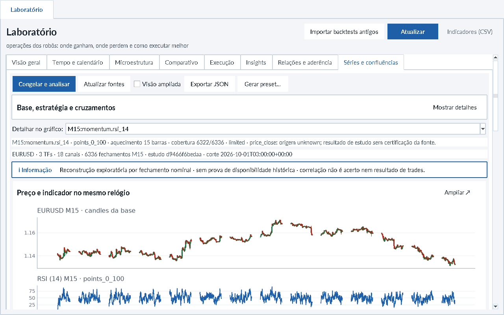
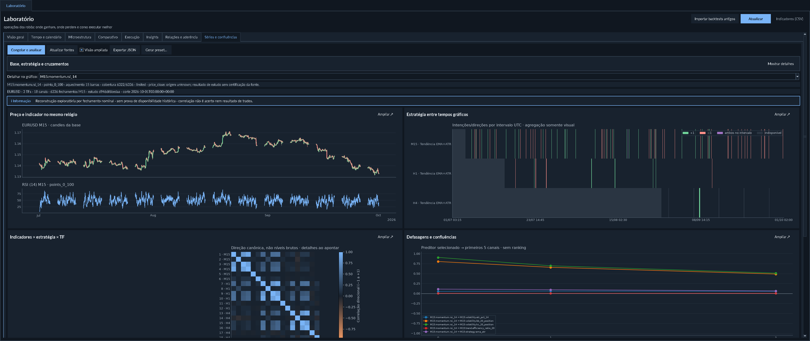

# Laboratório de séries e confluências — T20.22-LAB1

**Status após teste do proprietário em24/10/2026: incompleto, aceite funcional
reaberto.** [Pendências e critérios](../propostas/LAB_SUPER_ATR_PENDENCIAS_20261024.md).
Os percursos abaixo descrevem a implementação inicial e seus limites, não
comprovam funcionamento em todas as seleções reais do atalho central.

Entrega inicial solicitada em24/10/2026, sobre AIA-02a. A aba **Laboratório →
Séries e confluências** usa séries reais da base, congeladas por `datasets`.
Em **Relações e aderência**, Inventário e a matriz **Indicador × indicador** são
reais: a matriz é `service.relation_matrix` sobre a análise congelada em Séries
(a mesma do CLI `laboratory matrix`). Indicador × alvo, linha do tempo, ganhos e
perdas, convergências e candidatos continuam fixture F18 demonstrativa, pois o
alvo T18.6 ainda não tem produtor. Análises do livro de operações são separadas.

## Visões e percurso

1. Atualizar fontes; escolher ativo, TFs, janela, estratégia/parâmetros e indicadores.
   Parâmetros têm campos numéricos rotulados, limites do registry e aceitam vírgula
   decimal; o contrato da estratégia é validado antes da captura.
   Os TFs seguem duração crescente. Ausência de M5, por exemplo, não cria M5 a
   partir de M1 silenciosamente. A frente de dados mantém a derivação/coleta.
2. **Congelar e analisar** cria revisões pelo store de snapshots existente e
   calcula as fórmulas registradas. Nenhum backtest, ordem, download ou otimização
   é disparado. Alterar a seleção mantém o resultado congelado identificado;
   uma resposta de seleção antiga não substitui a atual.
3. **Preço e indicador:** candles da base e valores originais, no mesmo relógio.
   Linhas de preço sobrepõem o preço apenas quando seu contrato permite; demais
   unidades ficam em painel próprio. Quebras de tempo interrompem as linhas.
4. **Estratégia entre tempos:** intenções fechadas da mesma estratégia e mesmos
   parâmetros em todos os TFs. São candidatos, não trades ou posição persistente.
5. **Indicadores × estratégia × TF:** matriz de correlação das direções canônicas,
   escala fixa de−1 a+1 e ausências distintas de zero. Dicas mostram identificadores,
   amostra e motivo de indisponibilidade.
6. **Defasagens:** preditor selecionado no detalhe, respostas de outros canais,
   atrasos0/1/3 barras da grade. As duas orientações, inclusive TF maior→menor,
   estão no JSON. A tela mostra os primeiros cinco pares na ordem do catálogo,
   sem ordenar retrospectivamente pelo melhor efeito.
7. **Cobertura:** barras da grade com valores calculáveis; detalhe da seleção
   mostra requisitos, motivos, unidade e aquecimento. Cobertura não certifica fonte.

**Visão ampliada** organiza duas colunas e gráficos maiores; inicia habilitada
quando monitor **e janela** têm largura>1920 **e** altura>1080. Uma janela
compacta num monitor grande continua compacta até a escolha do usuário. Em tela menor,
a ampliação mantém rolagem horizontal e a página mantém rolagem vertical.
Cada gráfico tem **Ampliar/Restaurar**: detalhe no monitor da janela lançadora,
toolbar de zoom/pan e Escape para voltar, usando o mesmo resultado. Não altera
resolução do host nem manipula janela alheia. Navegação por nomes completos é
reutilizada quando as abas não cabem. Claro/escuro usam os tokens existentes.

Para impedir que um sinal raro desapareça na redução de milhares de colunas da
linha temporal, cada intervalo visual conserva compra/venda; se houver ambos,
mostra roxo, **não neutro**. Essa agregação é apenas gráfica, com intervalo na
dica. Métricas e JSON conservam todos os valores. A matriz não mede valores
brutos de unidades incompatíveis: a regra direcional e sua legenda são explícitas
no canal. Isso é uma convenção descritiva, não um gatilho financeiro novo.

## CLI e SDK, sem desktop

```sh
python -m mt5_extracao.cli --json laboratory catalog
python -m mt5_extracao.cli --json laboratory sources
python -m mt5_extracao.cli --json laboratory freeze --symbol EURUSD \
  --tf M15 --tf H1 --tf H4 --start 2026-07-01 --end 2026-09-30T23:59:59
python -m mt5_extracao.cli --json laboratory analyze \
  --manifest ID_M15 --manifest ID_H1 --manifest ID_H4 \
  --strategy ema_atr --params '{"fast":20,"slow":50,"trend":200,"stop_atr":2.0,"trail_atr":3.0}' \
  --feature momentum.rsi_14 --feature volatility.bb_20_position \
  --as-of 2026-10-01T03:00:00Z --out diagnostico-novo.json
```

```sh
python -m mt5_extracao.cli --json laboratory matrix --analysis diagnostico-novo.json --lag 3
```

`matrix` lê só o JSON exportado (sem base): Spearman dos valores alinhados na
grade nominal, preditor deslocado `--lag` barras (0, 1, 3 ou 6), com correlação de
direção, veredito fora da amostra e IC copiados do par do relatório. Célula sem
efeito traz `reason` distinto: `UNCONFIRMED_EVENT` (pivô provisório),
`SAME_SERIES` (diagonal com defasagem), `NO_OVERLAP`, `INSUFFICIENT_PAIRS`,
`CONSTANT_SERIES` (zero válido constante não é ausência) ou o diagnóstico do canal
vazio (`WARMUP_EXCEEDS_WINDOW`, `INELIGIBLE_DATA`, `NO_VALUES`).

Relógio: `freeze` recusa antes de congelar quando o fuso do servidor não está
declarado e explica a ação. Um `broker_utc_offset` fixo só é correto se o
servidor não muda de horário dentro da janela; servidor com horário de verão
exige `broker_timezone` com `time_basis = utc`, que `datasets.capture` ainda não
aceita (contrato pendente na frente de Dados).

Os IDs vêm da resposta de `freeze`. `catalog` não abre banco, Tk ou MT5.
`sources` é leitura; `freeze` é escrita explícita no store canônico, sem tabela
paralela. `analyze` reabre os manifests e não altera fontes. `--strategy-only`
dispensa indicadores; sem `--feature`, usa cinco definições padrão do catálogo.
`--out` e a exportação da UI recusam sobrescrever arquivos existentes.

O congelamento desta visão continua em `DatabaseManager.data_inventory` com TFs
nativos do enum, consumidos por `datasets.capture`. M7 e M9 não entram nesse
enum. A leitura gráfica usa o que já está em `_bars_derived`: `laboratory.derived`
chama `analytics.resampling.latest_bars` e desenha só a última revisão fechada.
O rótulo é sintético, âncora 00:00 do calendário da corretora, não é tempo do
MT5. A UI não agrega, não preenche buraco e não mistura esses tempos com a
captura nativa. Um tempo sozinho é só a leitura, sem indicador. Dois ou mais
tempos de dia exato comparam a mesma seleção na grade do fechamento mais curto:
defasagem 0 descreve, defasagens 1/3/6 são candidatas preditivas, e um intervalo
sem grupo completo não vira candle nem par. CLI: `laboratory derived --relations`.
A seleção inicial marca só tempos nativos cuja série inteira
cabe em 20 mil barras; um tempo maior aparece na lista com a contagem e, ao
congelar sem janela, preenche De com o início das últimas 20 mil barras em
vez de carregar a série toda. Recarregar as fontes não descarta uma análise
que ainda está em curso se a seleção marcada não mudou. Sem `--relations`, `laboratory derived` só lê. Sessões e fatos materializados com
disponibilidade real continuam no Analytics/BD18a. “Sem série compatível”
nesta visão não significa que a base inteira esteja vazia.

```python
from mt5_extracao.laboratory import analyze, capture_selection, catalog

snapshots = capture_selection(db, symbol="EURUSD", timeframes_selected=["M15", "H1"])
diagnostic = analyze(snapshots, strategy_key="ema_atr",
                     feature_ids=["momentum.rsi_14"], as_of="2026-10-01T03:00:00Z")
```

### Descritiva × preditiva (LAB-07)

Cada par traz `relation`: `DESCRIPTIVE` na defasagem 0 (co-movimento) e
`PREDICTIVE_CANDIDATE` com defasagem 1/3/6 (o preditor antecede o alvo na grade).
Os preditivos trazem `out_of_sample`: corte cronológico fixo 70/30 (não
otimizado), correlação e n de ajuste e fora da amostra e `verdict`
(`HOLDOUT_CONSISTENT`, `HOLDOUT_SIGN_FLIP`, `HOLDOUT_WEAK`, `FIT_WEAK`,
`WITHIN_NULL`, `NO_GAIN_OVER_PERSISTENCE`, `HOLDOUT_INSUFFICIENT` com menos de 30
pares). Dois controles no trecho fora da amostra: `null_band_95` (quantil 95% de
|r| sob deslocamentos circulares do preditor, que preservam autocorrelação e
retenção) e `naive_holdout_correlation` (o próprio alvo com a mesma defasagem).
Só é consistente o que supera ambos e cujo `holdout_ci_95` (bootstrap de
blocos móveis, 200 reamostras, semente fixa) exclui zero; senão `CI_INCLUDES_ZERO`.
Defasagens preditivas fixas: 1, 3 e 6 barras da grade (`PREDICTIVE_LAGS`). Campos aditivos: o `analysis_id`
de seleções existentes não muda. Consistente fora da amostra não é previsão
calibrada, lucro nem validação de estratégia.

Eventos não confirmados: canais de pivô (`structure.*`, fractais e ZigZag causal)
trazem `events`. Em top/bottom, `basis=confirmation_bar_close`: o valor só existe
a partir do fechamento da barra de confirmação, nunca na origem; `confirmations`,
`delay_bars` (mín/mediana/máx origem→confirmação) e
`bars_since_last_confirmation` expõem atraso e envelhecimento do último pivô
retido. A saída `provisional` é desenho (`usable=false`): diagnóstico
`UNCONFIRMED_EVENT` e todos os seus pares saem com `reason=UNCONFIRMED_EVENT`,
sem correlação. Demais canais têm `events=null`.

### Estudo do gráfico (LAB-08)

A bancada gráfica grava um estudo JSON v2 (`laboratory/annotations.py`):
`analysis_id`, identidade (ativo, TF da grade, seleção, e por série id/nome/TF/
unidade/parâmetros/versão/fonte), anotações (`hline`, `vline`, `region`, `note`),
séries ocultas e removidas da vista e a vista (zoom `xlim` e cursor). Ocultar ou
remover uma série altera só o estudo, nunca o relatório congelado. Reabrir recusa
estudo de outra análise ou que cite série ausente; o v1 da prévia anterior ainda
é lido até a v2 ser aceita.

```sh
python -m mt5_extracao.cli --json laboratory study \
  --analysis diagnostico-novo.json --study estudo.json
```

O comando valida e resume (anotações, séries visíveis/ocultas/removidas, vista)
sem Tk. O Estudo MT5 (`chart_study`) segue com outra responsabilidade: captura
e notas sobre o gráfico do terminal; o estudo do Laboratório não o substitui nem
abre uma janela MT5.

O workflow AIA-01 descobre esses comandos no argparse real e os executa por
`cli.run`, com os mesmos envelopes/erros, sem shell ou mouse. Não há outro
scheduler, cache, feature store, journal ou servidor.

O relatório v1 inclui `analysis_id`, hash das fontes de cálculo, seleção de
manifests/parâmetros/corte, relógios, origem, qualidade, sementes, valores,
direções, timestamps das barras de origem e pares. `source_rows/source_available`
e `candidate_counts` contam barras **do TF de origem**; `available/total` e
`n_pairs` contam a **grade alinhada**. Uma intenção H4 retida em16 instantes M15
continua um candidato de origem, não16 entradas ou observações independentes.
Cada par explicita quantas barras distintas de cada lado foram reutilizadas.

## Fronteiras matemáticas e de dados

- Um ativo, mesma origem lógica/provider/server/offset declarado, até8 TFs,
 32 canais e20mil barras por TF. Recortes maiores são recusados explicitamente;
 não há truncamento escondido. Os limites contêm esta análise, não substituem
 orçamento de campanha ou Budget dos backtests.
- Cada fórmula reutiliza `analytics.indicator_registry`; estratégias usam
 `gerar_sinais` e validação tipada da composição existente. O registry resolve
 períodos/fórmulas/ausências; não há cópia dessas fórmulas no widget.
- A grade usa fechamentos do menor TF. Em cada ponto, join somente para trás
 pelo **fechamento nominal**, com validade até o próximo fechamento nominal da
 origem. Buracos não viram valor retido indefinidamente; barras ainda abertas,
 relógios desconhecidos, sobreposição, duplicatas ou origem incompatível recusam.
- Esta reconstrução não é o leitor point-in-time BD18a. Sem o histórico de
 recebimento/revisão, um fechamento nominal não prova que o dado estava disponível
 naquela data. Os flags de disponibilidade histórica/independência/aceite continuam
 falsos. Não alimenta OOS, reserva intocada, treino ou escolha automática de preset.
- Qualidade do snapshot e do prefixo fechado são verificadas. Volume real
 desconhecido/zero não ganha fallback para ticks. Warmup/NaN/constante e amostra
 insuficiente não viram correlação zero ou perfeita.
- Pearson sobre direção mede associação descritiva. Retenção, autocorrelação,
 neutros, regimes e múltiplas tentativas impedem interpretar isso como taxa de
 acerto, causalidade, probabilidade calibrada ou promessa de lucro. Acordo total
 e acordo somente com ambos ativos são separados, sem p-valores improvisados.
- Cada TF conserva a semente da sua janela. Isso não prova seed global, paridade
 Profit/MT5, estabilidade em janela móvel1500, fills ou SL/TP aplicados.

## Gerador de presets integrado

**Gerar preset…** leva o ativo e um TF do resultado congelado ao fluxo
Default/Manual existente da aba Robôs. Escolha o Expert e revise seus próprios
parâmetros: uma estratégia exploratória Python não autoriza uma tradução implícita
para outro Expert. A validação de versão/pin/inputs/closure ocorre antes de abrir
o editor. Falha restaura a seleção anterior; sucesso identifica o novo contexto
também no card. Nome, revisão, conflitos concorrentes, `.set`+manifesto,
exportação/importação e recibo carregado permanecem nos serviços atuais.

Para IA, os métodos `presets.default/save/revise/export/import/select` do workflow
já oferecem esse mesmo gerador sem janela. Não foi criado um segundo schema de
preset. Gerar/exportar não inicia robô nem aprova estatística ou execução.

**Conferência da biblioteca instalada em24/10:** os seis perfis encontrados
(S09, Pullback, S10, VWAP, Madrid e HA/HiLo) foram recusados pelo contrato de
fonte/versão/fingerprint/inputs. A closure H de desenvolvimento avançou e não é
uma das snapshots aprovadas desses perfis. A ponte visual/CLI está disponível;
geração operacional sobre essa closure permanece bloqueada. Nenhum pin ou risco
foi relaxado nesta entrega. O próximo recorte operacional deve qualificar um
pacote completo por perfil/revisão (começar por S09), preservar versões anteriores,
compilar/conferir inputs/recibo e registrar seus próprios aceites. Não substituir
a biblioteca atual inteira por headers antigos para contornar esse bloqueio.

## Inventário, investigações e próximos recortes

Nesta ponta,52 definições Analytics e11 estratégias foram descobertas do código.
Foram exercitadas em histórico EURUSD numa base privada de QA, lido do banco do
proprietário com SQLite `mode=ro/query_only`. A cópia de trabalho não altera o
banco original, sua identidade ou a posse do agente de dados. As52 definições
foram percorridas em lotes e as11 estratégias em M15/H1/H4. Resultado é
diagnóstico de disponibilidade/candidatos, sem simulação financeira ou ranking.

O catálogo nativo de Estudo tem38 fábricas e outra semântica. ADX/ADX Wilder,
SAR, CCI, Ichimoku e outros não ganham um contrato histórico por parecerem
similares a uma fórmula Python. Mesmo ATR, RSI, Fractals, Alligator e MACD
requerem conferir seed, variante, confirmação/deslocamento e parâmetros antes de
alegar paridade. Os38 continuam acessíveis pelo SDK gráfico AIA-02a.

Frentes separadas a continuar:

| Frente | Próximo contrato/aceite |
|---|---|
| Dados + catálogo | Materialização/versionamento dos itens ausentes, inclusive ADX/Super ATR/indicador estratégico, pelo dono dos dados; disponibilidade/revisão/clock explícitos |
| Comparativo de execuções | Mesmo preset/revisão/composição, custos, janela/modelo e datasets; P&L/equity/drawdown, não mistura de runs mais recentes por TF |
| Inspetor T20.23 | Cursor/zoom vinculados entre painéis, tabela→evento, fluxo/stops/equity somente com evidência própria |
| Experimentos T20.12/13 | Pré-registro de hipóteses, tentativas, OOS, maturidade e controle de multiplicidade; sem transformar esta exploração em qualificação |
| Presets T19.27/28/32 | Geração/seleção automática apenas com contratos estatísticos, compatibilidade e execução existentes; sem escolher retrospectivamente o melhor par |
| Carteira/regimes | Comparação entre ativos, custos, sessões, estabilidade, regimes, sensibilidade e manutenção operacional com suas identidades próprias |
| Qualificação de ambiente | Windows físico, DPI/múltiplos monitores físicos e limites de interação em séries maiores têm evidência própria; sem promessa de FPS |

Esta entrega amplia o percurso T20.22 com dados reais. Não declara concluídos
T20.22 completo, T20.23, gerador automático, OMNI ou aceites financeiros.

Capturas de QA do componente real, em Xvfb próprio (sem conta/terminal):





Detalhe ampliado e tema claro estão na mesma pasta. A validação e seus cortes
estão na [evidência](../evidencias/T20_22_LABORATORIO_SERIES_20261024.json).

### Contagem de eventos de pivô (28/10/2026)

Canais de fractais/ZigZag acrescentam `event_confirmation_ends`: em cada barra da
grade, o fechamento nominal da confirmação que sustenta o valor retido. Origem,
barra de confirmação e disponibilidade nominal do último pivô ficam em
`events.latest`. Recebimento histórico continua não comprovado.

Cada par acrescenta `event_sample` com `left_events`, `right_events` e
`unique_event_pairs`. As contagens usam só pares válidos, após lag e exclusões;
um lado sem pivô tem `None`, não zero. O holdout tem sua própria contagem em
`out_of_sample.event_sample`. Não são tamanho efetivo de amostra nem prova de
independência; os controles 70/30 continuam por barras. O hover das relações e
matrizes mostra essa diferença. Relatórios antigos não recebem contagens
inferidas. Fórmulas, parâmetros e limiares continuam os mesmos.
São eventos representados pelos valores dos pares; um evento anterior ao corte
que continua retido no holdout conta como representado, sem se tornar uma nova
confirmação. O resumo JSON de `laboratory derived --relations` preserva essas
contagens e os metadados do canal, sem despejar preços por barra.
