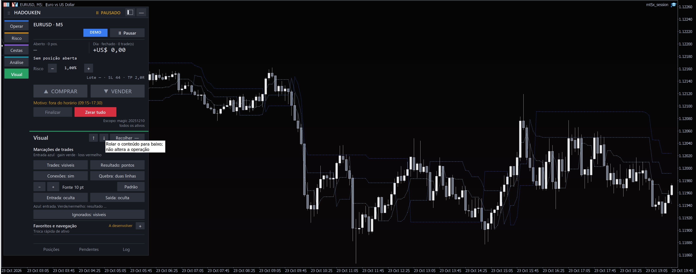
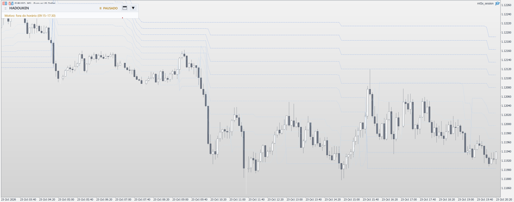

# Super ATR no gráfico do painel — G19.9

## Expert de pesquisa SA-01

Robôs → Importar robô → **Gerar Super ATR de pesquisa…** cria um consumidor
pelo scaffold e host HADOUKEN atuais. Escolha pasta de artefatos, raiz HADOUKEN
fixada e primeira barra real em horário broker, `YYYY-MM-DDTHH:MM`. O início
precisa existir/alinha-se em todos os TFs: baseM5/confirmadorM15 por padrão;
segundo confirmador opcional, mais longo. Apenas TFs nativos intradiários;
M7/M9/D/W/M são recusados. Nenhum pin ou perfil aceito é alterado.

Contrato `super_atr_closed_confirmation/0.1-research`, identificado no
`<Nome>.research.json` com hashes do consumidor, header e closure completa.
`robot.json` permanece no contrato1 existente, inputs tipados, preset explícito
com **entradas desligadas**, sem outra fórmula/OrderSend/gestor. Cópias de headers
no pacote são artefatos fechados de build, não outro checkout de desenvolvimento.
Também inclui os três ativos gráficos pela mesma resolução do catálogo.

- Curvas independentes por TF:20/SMA/desvio1/lado inicialup; hipótese congelada,
  sem selecionar melhor resultado retrospectivo. Alterações de parâmetros mudam
  fonte/preset/identidade e exigem novos testes.
- Nova virada do TF base entra apenas se cada última barra confirmadora fechada
  tem o mesmo lado. Fim da barra≤decisão e idade<um período nativo; simultâneos
  entram somente depois do fechamento. Sem interpolação/agregação escondida.
- Janela fixa desde a semente, até20.000 barras. Prefixo HLC/horários já observado
  é comparado exatamente; revisão incompatível trava novas entradas nesta instância.
  Dado inválido, não sincronizado, semente ausente e confirmação vencida recusam.
- Decisão na nova abertura base, consumida uma vez mesmo sem dados/ordem recusada.
  Restart pula a decisão corrente. Não certifica exclusividade entre instâncias,
  reinícios ou disponibilidade histórica das barras recebidas.
- SL inicial=linha base atual, sem TP. Saída na virada oposta independe da
  confirmação. Move Guard opcional/desligado usa o aperto existente; proteção,
  pausa, magic+símbolo, lotes/stops/tick/freeze e limites permanecem no host.
  Risco0,5%/trade, perdas2%diária/4%semanal/DD10%, no máximo1 posição.
- Gate Tester ou contaDEMO precede `StrategyInit` e é repetido em cada tick.
  Observação de execução do host está ligada; aceita/parcial/incerta trava nova
  entrada até reconciliação existente. Proposta de SL não é recibo de aceitação.

CLI pelo launcher: `--cli robots new MeuSuperATR --template super-atr-research
--dir PASTA --framework RAIZ --seed-start 2025-01-01T00:00 --tf M5
--confirm-tf M15` (`--second-confirm-tf H1` opcional). UI e
`sdk.create_super_atr_research_robot` usam o mesmo gerador. Nenhuma das três
entradas inicia MT5, compila ou arma ordens. Compile/check/Session oficiais
continuam necessários; PLAY continua indisponível sem run correspondente.
O preset conservador desligado não se torna autorização para armar entradas.

Validação no host:75 regressões App aprovadas e31 finais dirigidas (sobreposição);
7 contratos nativos herdados de pausa/proteção/observação aprovados. Probe explícito
`PYTHONPATH=. .venv/bin/python tests/super_atr_research_probe.py --framework RAIZ`
executa corpo MQL real+header em C++ com plataforma controlada: futuro alterado,
confirmação incompleta/vencida/ausente, revisão, sincronismo e deduplicação; não
simula fills. MetaEditor/Wine compilou consumidor e três indicadores com0erros/
0avisos, include tree própria e6 headers padrão verificados. Launcher gerou43
arquivos/23 inputs e exibiu candidato com entradas/PLAY desligados. Windows físico,
Tester DEMO, sessão/lease próprios, reconciliação de execução e qualificação
estatística/financeira permanecem pendentes. G19.15 não aprovou candidato sob os
custos assumidos; concordância não é probabilidade de ganho.

API de barras segue [CopyRates](https://www.mql5.com/en/docs/series/copyrates),
[PeriodSeconds](https://www.mql5.com/en/docs/common/periodseconds) e o gate usa os
[tipos de conta oficiais](https://www.mql5.com/en/docs/constants/environment_state/accountinformation).
A compilação isolada usa o compilador existente e `/include` conforme
[MetaEditor](https://www.metatrader5.com/en/metaeditor/help/beginning/integration_ide).

## Persistência SA-02

No Laboratório → Séries e confluências → Fontes vinculadas, selecione um ativo
com candles nativos e use **Materializar Super ATR…**. Informe a raiz canônica
HADOUKEN existente, janela em horário broker, período, média0=SMA/1=EMA e desvio.
A barra inicial fixa a semente; alongar a janela pelo fim preserva o prefixo.
O formulário mostra atividade e permite solicitar cancelamento; a etapa do
compilador termina antes de responder ao cancelamento. Não instala ferramentas.

O produtor usa o header e o adaptador C++ originais do HADOUKEN no commit do
manifesto oficial, sem outra fórmula Python. Grava `trend.super_atr.level`,
`trend.super_atr.atr` (números), `trend.super_atr.side` e
`trend.super_atr.turn` (categorias up/down/none). Lado inicial=up; primeiro valor
válido tem virada=none. ATRzero é válido. Warmup e sufixo inválido ficam
UNAVAILABLE, com motivo, sem preencher lacunas com zero. Fórmula, parâmetros,
seed, compilador, hashes do header/adaptador, versão, fonte, manifesto, abertura/
fim UTC, revisão e clocks acompanham os fatos no store/journal existentes.

`available_at` e `observed_at` são o recebimento local da materialização; o
fechamento nominal **não** prova recebimento histórico. Para estudar a curva
histórica, vincule a fonte congelada com **Publicação retrospectiva**, explicitando
esse limite. Consulta no corte anterior à materialização não retorna fatos.
Reexecução idêntica é idempotente; correção conserva o histórico as-of e revisa
o sufixo dependente. Fonte congelada/exportação reutilizam BD18/SDK existente.

CLI: `analytics features super-atr-capabilities --framework RAIZ` e
`analytics features super-atr-materialize --framework RAIZ --manifest ID
--period 20 --mean 0 --deviation 1`. Não altera pins, base principal, conta ou
ordens. Execução do header em C++ não certifica MetaTrader, Expert, Profit ou
desempenho financeiro. As evidências históricas de G19.9 abaixo são de escopo
distinto da materialização SA-02.

O estudoEURUSD/M5 usa DEZ curvas de período20, média aritmética0, com desvios
1 a10, conforme a ampliação solicitada pelo proprietário. Todas pontilhadas em azul, do claro ao escuro conforme o multiplicador.
Na virada, os pontos da mesma curva se ligam em diagonal pontilhada; não há
vazio por troca de estado. Essa ligação visual não muda o cálculo da catraca.
Cada curva pode mudar período, multiplicador e média0/1 (aritmética/exponencial)
nas Propriedades do indicadorMT5/Ctrl+I. Não são ordens ou stops aplicados.

Abrir PLAY do painel manual → Análise → Estudo → + Indicador →
“HADOUKEN · Super ATR · dez curvas”. Precisa da biblioteca candidata completa;
a App instala/compila o indicador antes do adaptador. Aparece na janela principal,
sem requerer uma subjanela. A biblioteca anterior, sem o marcador novo, continua
aceita pela App. Não usar o template anteriorEstudo_ATR_1_3 como especificação.

A linha usa fechamento±desvio×ATR, máxima retida na alta/mínima na baixa.
Inverte quando o fechamento cruza estritamente a linha anterior, resetando a
catraca. Igualdade conserva o lado. PrimeiraSMA completa semeia a média; EMA
seguealpha2/(N+1). Lado inicial explícito, alta por padrão. O candle corrente
é provisório e recalculado a partir da barra anterior, sem acumular várias
catracas no mesmo candle. HLC inválido/overflow torna o sufixo indisponível.

[Contrato matemático e notas teóricas](https://github.com/Misael-art/projeto-indicadores-mt5/blob/3a3137ca/Documentation/HADOUKEN_2/propostas/G19_9_SUPER_ATR.md).
Guarda: oATR altera a distância da BASE, mas a catraca pode impedir recuo da
linha já retida. Estado de alta/baixa é discreto; linha/ATR também guardam
memória numérica. Desvios distintos podem virar em barras diferentes e as
curvas não precisam permanecer aninhadas. Otimização por volatilidade/volume/
tendência/ativo e50 curvas são pesquisa futura, sem adaptação implementada.

Catálogo da App acrescenta somente o marcadorHDK_StudySuperATR.mqh → ativo
HDK_SuperATR.mq5 e fecha seus includes. Pin manuald377c812aafd0c5e foi conferido
na biblioteca real3b979cf1, três ativos e matemática; alterar a fórmula invalida
a identificação. Mantém pins antigos, conta, consentimentos, stop, limites e
exceção manual exclusiva. Nenhuma capacidade automática é ampliada; novos
fingerprints de outros consumidores precisam dos próprios aceites. Não
atualiza a distribuiçãoSafety nem o canal aceitoapp-current.

Validação local:126 testesApp;88HADOUKEN e checker161; compilação6281/Wine
0erros/0avisos nos três ativos e adaptador do painel. Identidade real conferida
com mutação recusada. Doctor20OK/1opcionalpandas-ta/0falhas, no perfil instalado
reutilizado (bootstrap/configuração não alterados). Versão1.01 compilada e inspecionada:EURUSD/M5, três curvas pontilhadas,
patamares e diagonais nos dois sentidos, fundoMinimalB&W/clean, sem marca
d’água/relógio, painel pausado e nenhuma exposição observada. A prova foi feita
na composição App0b2fda3 +He01540f3, que inclui a correção adicional de monitor
[PR204](https://github.com/Misael-art/MISA_MT5-Extra-o-de-Dados/pull/204).
Esta correção é necessária para preencher também a área interna Wine no monitor
maior; os runtimes de catálogo/pin destePR são idênticos nessa composição.
A prévia do atalho usa essa composição; canal aceito preservado. [Evidência](../evidencias/G19_9_SUPER_ATR_20261023.json).

Windows físico, referência numérica externaProfit,50curvas e aceites financeiros/
operacionais não são qualificados por este estudo. Alteração externa dos
parâmetros conserva a políticaG19 de preservar identidades modificadas:
controle/remoção pelo diálogoMT5 quando o controlador não reconhece a cópia.

Captura da área de gráfico3456×1363, monitor3456×1458 informado pelo sistema;
contagens dos pixelsRGB2940/2586/2493. Conexão diagonal é apresentação entre
amostras, sem mudar a catraca ou afirmar um caminho de preço intrabar.

### Versão1.02 — dez curvas e cinza claro

A versão1.02 amplia os inputs independentes para dez curvas. Preserva as
regras da catraca/diagonais. O tema **Cinza Claro** fica na última página de
Visual → Gráfico e temas; com Identidade do gráfico → Degradê ligado, o fundo
vai deRGB242 a210, neutro nos três canais. Marca d’água e Candle Time podem
ser desligados nos controles existentes. Índices dos15 temas anteriores
preservados. Versão1.02 instalada e inspecionada no atalho habitual, composta com
Appf7c3371/H3b979cf1:3456×1458,10 tonsRGB presentes, diagonais, fundo neutro
com amostras240/225/212, painel pausado e nenhuma ação de ordem enviada; a captura acima é
histórica1.01 de três curvas, não prova de dez.

Validação1.02:89Tools/checker161/compilação6281Wine0/0,126App; composição
monitor128 testes +58 dirigidos pósmerge (sobrepostos). PréviaAppf7c3371 e
H3b979cf1 têm runtime final; commits documentais posteriores não mudam fontes.
PLAY no dock3456×1458 e REPLAY no handheld1280×800 verificados separadamente;
replay foi de1.01 com indicadores anteriores, não prova das10 curvas.
